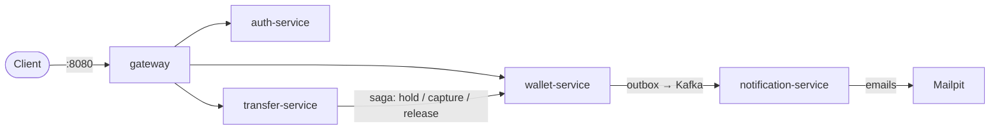

# Payments Microservices with Spring Boot — a course in chapters

A payments backend built **one concept at a time** with Java 21, Spring Boot 4.2 and Spring Cloud 2026.0.
Every chapter is a branch, a pull request and a document. Read the chapters in order, or check out
any chapter's branch to see the code exactly as it was at the end of that chapter.

The design is ported from a production-grade Go payments system. The Go code itself is not in this
tree any more; it lives in the git history, at the tag `go-reference` (see [Chapter 0](docs/00-course-setup.md#a-tour-of-the-go-original)).
We reuse its database schemas, its API contracts and its rules about money, and rebuild them the
Spring way, explaining every decision along the way.



## Chapters

| # | Chapter | Branch | What you build | Status |
|---|---------|--------|----------------|--------|
| 00 | [Course setup](docs/00-course-setup.md) | `ch00-course-setup` | The Go original, the roadmap, the workflow | ✅ |
| 01 | [Spring Boot foundations](docs/01-spring-boot-foundations.md) | `ch01-spring-boot-foundations` | Maven multi-module build, wallet-service skeleton, config, errors, logging | ✅ |
| 02 | [The double-entry ledger](docs/02-double-entry-ledger.md) | `ch02-double-entry-ledger` | Flyway, `JdbcClient`, wallets, deposits, balances, pagination, Testcontainers | ✅ |
| 03 | [Moving money safely](docs/03-safe-transfers.md) | `ch03-safe-transfers` | Row locks, lock ordering, retries, concurrency tests | ✅ |
| 04 | [Idempotency keys](docs/04-idempotency.md) | `ch04-idempotency` | Exactly-once money movement over an unreliable network | ✅ |
| 05 | [The auth service](docs/05-auth-service.md) | `ch05-auth-service` | A second service, database per service, Argon2, JWT, refresh tokens | ✅ |
| 06 | [The API gateway](docs/06-api-gateway.md) | `ch06-api-gateway` | Spring Cloud Gateway, JWT at the edge, Redis rate limits | ✅ |
| 07 | [Events and the outbox](docs/07-events-outbox.md) | `ch07-events-outbox` | Kafka, the transactional outbox pattern, a relay | ✅ |
| 08 | [The transfer service and sagas](docs/08-transfer-saga.md) | `ch08-transfer-saga` | Service-to-service HTTP, holds, an orchestrated saga with compensation | ✅ |
| 09 | [The notification service](docs/09-notification-service.md) | `ch09-notification-service` | Idempotent consumers, retries, a dead-letter topic, email | ✅ |
| 10 | [Resilience](docs/10-resilience.md) | `ch10-resilience` | Timeouts, retries, circuit breakers | ✅ |
| 11 | [Observability](docs/11-observability.md) | `ch11-observability` | Distributed tracing, metrics, dashboards | ✅ |
| 12 | [Shipping it](docs/12-shipping.md) | `ch12-shipping` | Container images, the whole system in Compose, CI | ✅ |

`git log --first-parent main` reads as the table of contents: one merge per chapter.
The current system, in detail: [docs/architecture.md](docs/architecture.md).

## Run the whole system

You need Docker and `openssl`.

```bash
./scripts/dev-keys.sh                                  # a local signing key for auth-service, in secrets/
docker compose --profile app up -d --build --wait      # infrastructure + the five services
./scripts/smoke.sh                                     # sign up, deposit, transfer, check balances and emails
```

| What | Where |
|---|---|
| The API (the only published service port) | http://localhost:8080, requests in [`api/gateway.http`](api/gateway.http) |
| Emails | Mailpit, http://localhost:8025 |
| Traces | Jaeger, http://localhost:16686 |
| Metrics | Prometheus, http://localhost:9090 |
| Dashboard | Grafana, http://localhost:3000 → Payments |

```bash
docker compose --profile app down -v
```

## Develop

You need Java 21 and Docker. Maven is optional: the project ships a Maven wrapper.

```bash
./mvnw verify                      # every module: unit tests, then integration tests (Testcontainers)
docker compose up -d --wait        # infrastructure only, then run any service from your IDE or:
./mvnw -pl wallet-service spring-boot:run
```

| Module | Port | Responsibility |
|---|---|---|
| `gateway` | 8080 (actuator 9080) | JWT checks, `X-User-ID`, rate limits, CORS, circuit breakers, routing |
| `wallet-service` | 8081 | Double-entry ledger: wallets, deposits, balances, holds; events via outbox |
| `auth-service` | 8082 | Users, argon2id passwords, RS256 access tokens, rotating refresh tokens, JWKS |
| `transfer-service` | 8083 | Transfers as orchestrated sagas over wallet holds |
| `notification-service` | 8084 | Emails from wallet events; idempotent, with a dead-letter topic |

## License

[MIT](LICENSE). The Go original this course ports is the work of its original author, under the same license.
This is teaching code: treat it as a starting point, not a drop-in system for moving real money.
