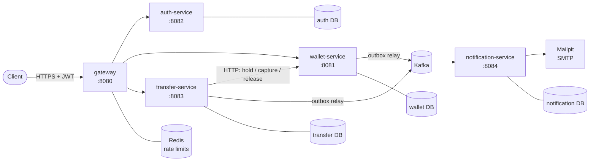
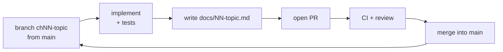

# Chapter 0 — Course setup

> **Branch:** `ch00-course-setup` · **Builds on:** nothing · **Go original:** the whole Go project (tag `go-reference`)

## What you'll learn

- What we are building, and why a payments system is a good way to learn microservices
- The rules about money that every chapter respects
- How the Go original system maps to Spring Boot, and the decisions behind that mapping
- How the course is organised: one chapter, one branch, one pull request

## Why this course starts from an existing system

Most microservices tutorials start with three empty services and a diagram. You learn the
vocabulary (gateway, saga, outbox) but not *why* you would ever need it.

We start differently. The repository we cloned is a complete payments backend written in Go: six
services, a double-entry ledger, sagas, an outbox, observability and more. It is our **reference
design**. It answers the hard questions — what does the database look like, what are the error
codes, what happens when the network fails half-way through a transfer — so we can focus on
learning how to build those answers in Spring Boot, one at a time.

We do not translate Go line by line. Where Spring has an idiomatic tool for a job, we use it, and
the chapter explains the trade-off.

## What we are building

A wallet system: users sign up, open wallets in a currency, deposit money and send it to each
other. By the end of the course it looks like this:



| Service | Port | Responsibility |
|---|---|---|
| gateway | 8080 | The only public entry point: JWT checks, rate limits, routing |
| wallet-service | 8081 | The double-entry ledger: wallets, deposits, balances, holds |
| auth-service | 8082 | Users, passwords, access and refresh tokens |
| transfer-service | 8083 | Transfers between users, run as sagas |
| notification-service | 8084 | Emails triggered by events |

## The rules about money

These come straight from the Go original, and the code never breaks them:

1. **Money is an integer count of minor units** (cents for USD, yen for JPY). Never a `double`.
   In Java that means `long`, not `double`, and not even `BigDecimal` for stored amounts.
2. **Money never travels without its currency.** An amount alone is meaningless.
3. **Balances are derived, never stored.** A balance is the sum of ledger entries. There is no
   `balance` column to get out of sync.
4. **Every transaction balances.** Its debits equal its credits in every currency. The database
   enforces this, not just the application.
5. **Every write that moves money is idempotent.** Retrying a request never moves money twice.
6. **Events leave through a transactional outbox.** If the money moved, the event is sent; if it
   didn't, the event isn't.

You will see each rule turn into code in a specific chapter.

## A tour of the Go original

The Go code lived in `reference/go/` while the course was written, and was removed once every
chapter was done: this repository is a Java project. Nothing is lost. The tag `go-reference` marks
the last commit that has it, and the Go project's own history (one commit per Go episode) is the
first 25 commits of this repository, from before chapter 0 moved the code into `reference/go/`:

```bash
git log --oneline --reverse | head -25            # the Go project's history, episode by episode
git checkout go-reference -- reference/go         # bring the code back into your working tree
git rm -rfq reference                             # and put it away again
```

Its layout, which the chapters refer to:

```
reference/go/
├── cmd/<service>/main.go       one entry point per service
├── internal/wallet/            the ledger: service.go (rules), store.go (SQL), http.go (API)
├── internal/auth/              users, argon2id passwords, tokens
├── internal/gateway/           JWT at the edge, rate limits, proxying
├── internal/transfer/          the saga: saga.go, state.go
├── internal/notification/      consumers and email
├── internal/platform/          shared plumbing: errors, idempotency, outbox, postgres retry
├── db/<service>/migrations/    one database per service, versioned SQL
└── api/*.http                  example requests
```

Each chapter's header names the Go files it ports, as paths inside `reference/go/`. The first line
of each Flyway migration also says which Go migration it came from; those comments stay as written,
because editing a migration that has already run changes its checksum (chapter 2).

## From Go to Spring: the translation table

| Concern | Go original | This course | Why |
|---|---|---|---|
| Web layer | `net/http` handlers | Spring MVC `@RestController` | The Spring default; familiar to the learner |
| SQL | `sqlc` (SQL in, typed code out) | Spring JDBC `JdbcClient` | A ledger is set-based, append-only SQL. Explicit SQL keeps the locking and the invariants visible. JPA would hide them. |
| Migrations | `golang-migrate` | Flyway | Spring Boot runs it on startup with zero code |
| Errors | custom JSON `{"error": {...}}` | RFC 9457 `ProblemDetail` | A standard, built into Spring, with the same stable `code` field |
| Logging | `slog` + request IDs | SLF4J/Logback + MDC, then Micrometer Tracing | Spring's built-in observability stack |
| Service-to-service | gRPC | HTTP interface clients (`@HttpExchange` + `RestClient`) | One protocol to learn; the patterns (deadlines, error mapping) are the same |
| Messaging | NATS JetStream | Apache Kafka + Spring Kafka | The most common broker in the Spring ecosystem |
| Gateway | hand-written proxy | Spring Cloud Gateway | Routing, filters and Redis rate limiting out of the box |
| Tokens | EdDSA JWTs | RS256 JWTs + a JWKS endpoint | Supported natively by Spring Security and the JDK, no extra crypto library |
| Passwords | argon2id | argon2id (`Argon2PasswordEncoder`) | Same algorithm |
| Tests | `testing` + testcontainers-go | JUnit 5 + Testcontainers | Same idea: real databases in throwaway containers |

## The roadmap

| # | Chapter | Concept | Go episodes |
|---|---------|---------|-------------|
| 00 | Course setup | The reference, the rules, the workflow | — |
| 01 | Spring Boot foundations | One well-built service: config, errors, logging, health | 1, 4 |
| 02 | The double-entry ledger | Data modelling for money, migrations, integration tests | 2, 3, 5 |
| 03 | Moving money safely | Concurrency: row locks, lock ordering, retries | 6 |
| 04 | Idempotency keys | Exactly-once effects over at-least-once delivery | 7 |
| 05 | The auth service | Splitting a second service out; database per service; JWT | 8 |
| 06 | The API gateway | One front door: authentication at the edge, rate limits | 10 |
| 07 | Events and the outbox | Asynchronous communication without losing events | 11 |
| 08 | The transfer service and sagas | Distributed transactions without 2PC | 9, 12 |
| 09 | The notification service | Consumers that survive duplicates and poison messages | 13 |
| 10 | Resilience | Timeouts, retries, circuit breakers | 9, 22 |
| 11 | Observability | Following one request through five services | 14 |
| 12 | Shipping it | Images, Compose, CI | 16 |

Topics the Go original covers that we leave for after the course — each is a good self-directed
exercise with the reference code as your guide: outbound webhooks (ep 17), multi-currency and FX
(ep 18), fraud checks (ep 19), reconciliation and reporting (ep 20), mTLS and security hardening
(ep 21), Kubernetes (ep 23) and chaos testing (ep 24).

### Why not start with microservices?

Notice that chapters 1–4 build **one** service. That is deliberate. Microservices are a way to
split a system that already works; splitting a system you don't understand yet just spreads the
confusion across the network. We get the ledger right first, then split the second service out in
chapter 5, when there is a real reason to: auth has different data, a different change rate and
different security needs.

## The workflow: one chapter, one pull request

Every chapter follows the same loop, and the git history shows it:



- Branches are named `chNN-short-topic`. They are **kept** after merging, so `git checkout ch03-safe-transfers`
  always shows the code at the end of chapter 3.
- PRs are merged with a merge commit, so `git log --first-parent main` reads as a table of contents.
- Every chapter updates three documents: its own chapter file, [`docs/architecture.md`](architecture.md)
  (the system as it is *now*), and the chapter table in the root `README.md`.

## Conventions used throughout

- **Packages by feature, not by layer.** `com.example.wallet.ledger`, not `controllers/`, `services/`.
- **Controllers translate, services decide, repositories talk SQL.** Business rules live in services,
  so every way into a service (HTTP today, Kafka tomorrow) gets the same rules.
- **Records for data.** Request/response DTOs and domain values are Java records.
- **Constructor injection only.** No field `@Autowired`.
- **Tests at two levels.** Fast unit tests for rules; integration tests against real PostgreSQL
  (Testcontainers) for anything that touches SQL. No H2: it would not run our triggers.

## Key takeaways

- A reference design lets you learn the *how* without guessing the *what*.
- The money rules are non-negotiable, and the database enforces the most important ones.
- We build one solid service before splitting anything, because microservices multiply both good
  and bad design.

**Next:** [Chapter 1 — Spring Boot foundations](01-spring-boot-foundations.md)
