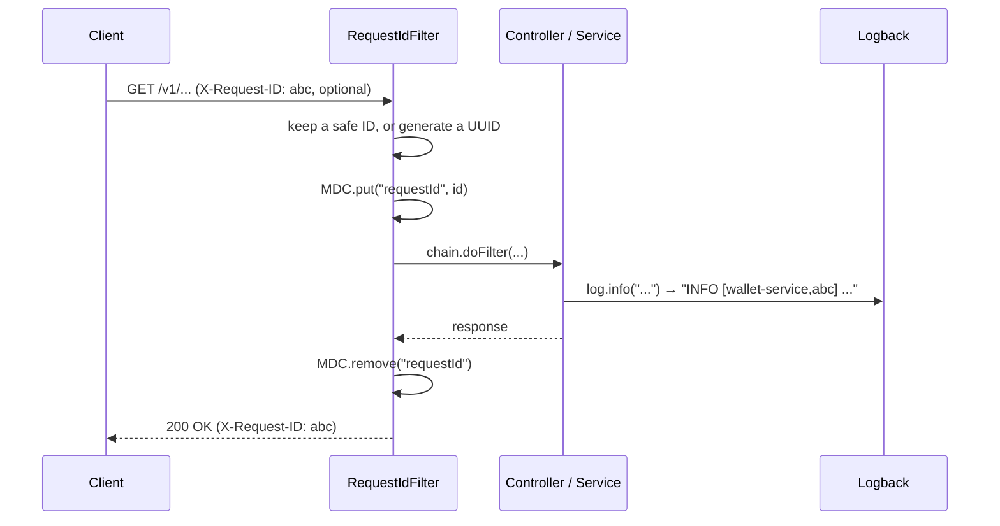

# Chapter 1 — Spring Boot foundations

> **Branch:** `ch01-spring-boot-foundations` · **Builds on:** [Chapter 0](00-course-setup.md) ·
> **Go reference:** `cmd/wallet/main.go`, `internal/platform/config`, `internal/platform/apperr`,
> `internal/platform/httpx/{errors,requestid}.go`

## What you'll learn

- How to lay out a multi-service Maven build so each service is its own deployable jar
- Type-safe, validated configuration with `@ConfigurationProperties` records
- An error contract clients can rely on: RFC 9457 Problem Details with a stable `code`
- Why a sealed exception hierarchy makes error handling safer
- Request IDs and the logging MDC: finding one request's logs among thousands
- Health probes and graceful shutdown: being a good citizen on a container platform
- Three kinds of tests — unit, slice and integration — and when to use which

## The problem

A microservices system is only as good as its weakest service. Before we write any business
logic, every service needs the same boring foundations, done well:

- **Configuration** that fails fast. A typo in a property should stop the service at startup,
  not cause a wrong answer at 3 a.m.
- **Errors** that clients can program against. If one endpoint returns `{"message": "..."}`, another
  returns plain text and a third returns a stack trace, every client becomes a pile of special cases.
- **Traceability.** When a user reports "my deposit failed", you need to find *that* request's logs.
- **Operability.** The platform running the service must be able to ask "are you alive?" and
  "can you take traffic?", and stopping the service must not drop requests half-way.

We build these once, in the wallet service. Later services copy the pattern.

## The concepts

### One repository, many deployables

```
payments/
├── pom.xml                  parent: Spring Boot version, Java version, shared plugins
├── mvnw                     Maven wrapper: everyone builds with the same Maven
└── wallet-service/
    ├── pom.xml              this service's dependencies
    └── src/...
```

The parent `pom.xml` inherits from `spring-boot-starter-parent`, which pins compatible versions of
every library. Each service is a **module** that builds into its own runnable jar. This is a
*monorepo*: one repository, many services. It keeps the course in one place and makes changes
that span services reviewable in one PR. The services still share **no code and no database** —
the module boundary is the service boundary.

> **Why not a shared `common` module for errors and filters?** Shared libraries couple services:
> change the library and every service must be rebuilt and redeployed together, which is exactly
> what microservices try to avoid. A little duplication of *infrastructure* code (an exception
> handler, a filter) is cheaper than that coupling. Share contracts (API shapes, event schemas),
> not implementation.

### Configuration as a validated record

```java
@Validated
@ConfigurationProperties("wallet")
public record WalletProperties(
        @Positive long maxAmount,
        @NotNull @Valid PageSize pageSize) {

    public record PageSize(@Min(1) int defaultSize, @Min(1) @Max(1000) int max) {}
}
```

```yaml
wallet:
  max-amount: 100000000   # a million dollars, in cents
  page-size:
    default-size: 20
    max: 100
```

Compared with `@Value("${wallet.max-amount}")` sprinkled through the code, a properties record is
**typed** (a `long`, not a string), **grouped** (one class documents every setting), **immutable**
and **validated at startup**: set `wallet.max-amount=-1` and the application refuses to start,
naming the bad property.

### The error contract: Problem Details

Every error from every service has the same shape, defined by
[RFC 9457](https://www.rfc-editor.org/rfc/rfc9457):

```json
HTTP/1.1 422 Unprocessable Content
Content-Type: application/problem+json

{
  "title": "Unprocessable Content",
  "status": 422,
  "detail": "invalid input: amount",
  "code": "invalid_input",
  "fields": { "amount": "must be a positive number of minor units, like 1050 for 10.50" },
  "request_id": "4f1c2a9e-..."
}
```

- `code` is **the contract**: short, stable, machine-readable. Clients branch on it.
- `detail` is for humans and may change between releases.
- `fields` appears on validation errors and lists *every* bad field at once.
- `request_id` lets a support engineer find the logs.

The Go reference has the same idea with a custom envelope (`{"error": {"code": ...}}`). We use the
standard, because Spring supports it natively and clients may already have tooling for it.

| Exception | Status | `code` |
|---|---|---|
| `ValidationException` | 422 | `invalid_input` |
| `RuleViolationException` | 422 | its own, like `insufficient_funds` |
| `NotFoundException` | 404 | `not_found` |
| `ConflictException` | 409 | `conflict` |
| malformed JSON | 400 | `malformed_request` |
| anything else | 500 | `internal` (the message is hidden and logged) |

### Exceptions say *what*, the handler says *how*

Business code throws exceptions that know nothing about HTTP:

```java
public sealed abstract class PaymentsException extends RuntimeException
        permits NotFoundException, ConflictException, ValidationException, RuleViolationException { ... }
```

One `@RestControllerAdvice` translates them, with a `switch` over the sealed hierarchy:

```java
ProblemDetail problem = switch (ex) {
    case NotFoundException e -> problem(HttpStatus.NOT_FOUND, "not_found", e.getMessage());
    case ConflictException e -> problem(HttpStatus.CONFLICT, "conflict", e.getMessage());
    case ValidationException e -> { ... yield p; }
    case RuleViolationException e -> problem(HttpStatus.UNPROCESSABLE_CONTENT, e.code(), e.getMessage());
};
```

Because the hierarchy is `sealed`, the switch needs no `default`, and **adding a new exception type
without deciding its status is a compile error**. Because the exceptions are HTTP-free, the same
service code works when it's called from a Kafka consumer in chapter 7.

### Request IDs and the MDC



The MDC (Mapped Diagnostic Context) is a per-thread map that Logback can print in every line. The
filter accepts an incoming ID only if it is short and made of safe characters — otherwise an
attacker could inject fake log lines with a newline — and **always clears it in `finally`**,
because servlet threads are pooled and reused.

In chapter 11 we replace this with distributed tracing, which carries the ID across services.

### Health probes and graceful shutdown

```yaml
server:
  shutdown: graceful
management:
  endpoint:
    health:
      probes:
        enabled: true
```

- `GET /actuator/health/liveness` — "is the process alive?" If not, the platform restarts it.
- `GET /actuator/health/readiness` — "can it take traffic?" If not, the platform stops routing to it.
- Graceful shutdown stops accepting new requests on `SIGTERM` and finishes the in-flight ones.

## Step by step

1. **Parent pom** — [`pom.xml`](../pom.xml): inherit `spring-boot-starter-parent` 4.2.0, set
   `java.version` to 21, list the `wallet-service` module, enable the Failsafe plugin.
2. **Maven wrapper** — `mvn -N wrapper:wrapper` generates `mvnw`, so nobody needs a matching Maven install.
3. **Service pom** — [`wallet-service/pom.xml`](../wallet-service/pom.xml): `spring-boot-starter-webmvc`,
   `-validation`, `-actuator`; test starters for MockMvc and `RestTestClient`.
4. **Application class** — `WalletApplication` with `@ConfigurationPropertiesScan` so properties
   records are found automatically.
5. **Configuration** — `config/WalletProperties` and [`application.yml`](../wallet-service/src/main/resources/application.yml).
   Note `spring.jackson.property-naming-strategy: SNAKE_CASE`: Java fields are `createdAt`, JSON is `created_at`.
6. **Money** — `money/Money` (a `long` and a currency) and `money/MoneyRules`, the checks every
   amount passes before it moves. We use them from chapter 2 on.
7. **Errors** — the `error` package (`PaymentsException` and friends, `FieldErrors` collector) and
   `web/ApiExceptionHandler`. The handler extends `ResponseEntityExceptionHandler` so Spring's own
   errors (unknown route, bad JSON, wrong method) get the same shape, via `createResponseEntity`.
8. **Request IDs** — `web/RequestIdFilter`, plus a `logging.pattern.level` that prints it.
9. **CI** — [`.github/workflows/ci.yml`](../.github/workflows/ci.yml) runs `./mvnw verify` on every PR.

## Run it

```bash
./mvnw -pl wallet-service spring-boot:run
```

```bash
curl -i localhost:8081/actuator/health/readiness
```

```bash
curl -i localhost:8081/v1/nothing-here
```

The second call returns a `404` with `Content-Type: application/problem+json`, a `code` of
`not_found` and an `X-Request-ID` header. Send your own ID with `-H 'X-Request-ID: hello-1'` and
watch it come back, and appear in the log line.

## Test it

```bash
./mvnw test     # unit + slice tests only: seconds
./mvnw verify   # plus integration tests (*IT)
```

| Test | Kind | What it proves |
|---|---|---|
| `MoneyRulesTest`, `FieldErrorsTest` | Unit | Pure Java rules; no Spring, milliseconds |
| `WalletPropertiesTest` | Context runner | Properties bind, and a bad value stops startup |
| `RequestIdFilterTest` | Unit, with servlet mocks | IDs are kept, replaced when unsafe, cleared after the request |
| `ApiExceptionHandlerTest` | `@WebMvcTest` slice | Every exception maps to the right status, `code` and shape; 500s leak nothing |
| `WalletApplicationIT` | Full app on a random port | Everything is wired: health, routing, headers |

The pattern to remember: **many fast unit tests, a few slice tests per layer, very few full-app
tests.** `@WebMvcTest` starts only the web layer, so it's quick; the test declares a throwaway
controller that throws each exception, so we test the handler without any business code.

## How this connects

Chapter 0 set the rules; this chapter builds the frame every service will share. The error
contract, `FieldErrors` and `MoneyRules` are used by every endpoint from chapter 2 on, and the
auth, transfer and notification services in later chapters follow the same layout.

## Key takeaways

- Fail fast on bad configuration: validated `@ConfigurationProperties` records.
- Give clients a stable error **code**; keep messages for humans; hide internals on 500.
- Keep HTTP out of business exceptions; translate in one place.
- Sealed hierarchies + pattern-matching `switch` turn "forgot a case" into a compile error.
- Request IDs in the MDC make logs searchable; always clear thread-local state.
- Prefer a little duplicated infrastructure over a shared library that couples services.

## Exercises

1. Add a `405` test to `ApiExceptionHandlerTest` (call a `GET` route with `POST`) and check the `code`.
2. Set `wallet.page-size.max=5000` and start the app. Read the startup failure message.
3. Change the log pattern to JSON with Spring Boot's structured logging
   (`logging.structured.format.console=ecs`) and look at where the request ID ends up.

**Next:** [Chapter 2 — The double-entry ledger](02-double-entry-ledger.md)
