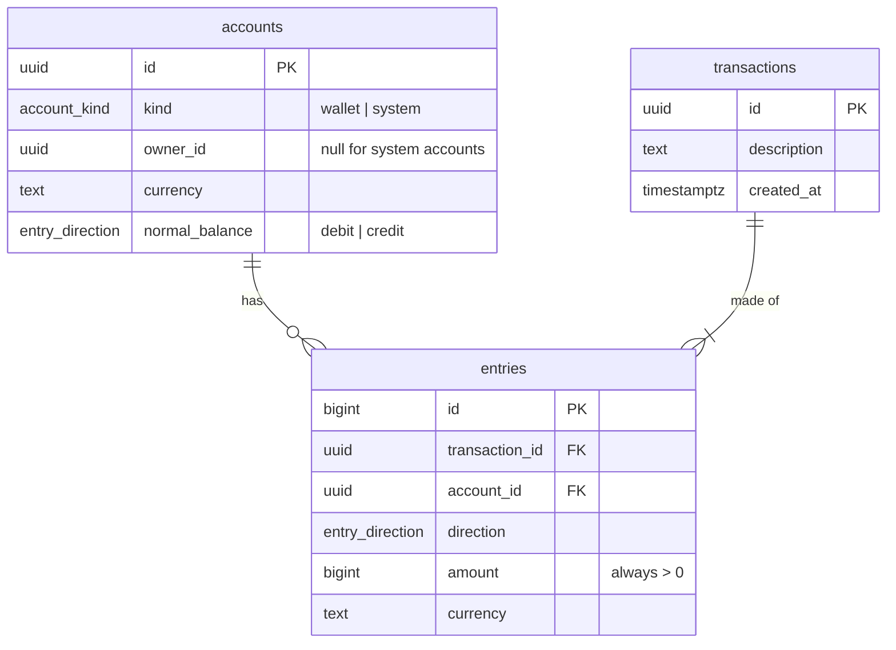
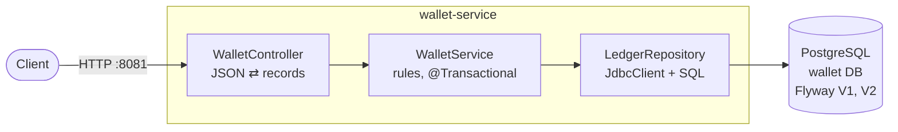

# Chapter 2 — The double-entry ledger

> **Branch:** `ch02-double-entry-ledger` · **Builds on:** [Chapter 1](01-spring-boot-foundations.md) ·
> **Go reference:** `db/wallet/migrations/00000{1,2}_*.up.sql`, `db/wallet/queries/{accounts,ledger}.sql`,
> `internal/wallet/{service,ledger,store,http}.go`

## What you'll learn

- Double-entry bookkeeping, and why every serious payments system uses it
- How to make the **database** enforce your most important invariants
- Versioned schema migrations with Flyway
- Plain-SQL data access with Spring's `JdbcClient`, and when to prefer it over JPA
- Transaction boundaries with `@Transactional`, including `Propagation.MANDATORY`
- Keyset (cursor) pagination, and why `OFFSET` gets slower every page
- Integration tests against real PostgreSQL with Testcontainers and `@ServiceConnection`

## The problem

The obvious design for a wallet is a table with a `balance` column:

```sql
UPDATE wallets SET balance = balance + 1050 WHERE id = ?;
```

It works until it doesn't. When a balance is wrong, there is no record of *why*: the history was
overwritten. A bug that adds money in one place and forgets to subtract it elsewhere creates money
from nothing, silently. And auditors, regulators and your own finance team will ask "show me every
movement of money", which this design can't answer.

## The concept: double-entry bookkeeping

Accountants solved this five hundred years ago. **Money never appears or disappears; it moves
between accounts.** Every movement is a *transaction* made of *entries*, and in every transaction
the debits equal the credits.



A deposit of $10.50 is one transaction with two entries:

| Account | Kind | Normal balance | Debit | Credit |
|---|---|---|---|---|
| settlement (USD) | system — money we hold at our bank | debit | 1050 | |
| Alice's USD wallet | wallet — money we owe Alice | credit | | 1050 |

Both balances grow (each by its normal side), and debits = credits, so the books balance. Later
chapters add transfers (debit Alice, credit Bob) and holds, but the shape never changes.

**Balances are derived:** a balance is the sum of an account's entries, computed by a view:

```sql
CREATE VIEW account_balances AS
SELECT a.id AS account_id, a.currency,
       coalesce(sum(CASE WHEN e.direction = a.normal_balance THEN e.amount ELSE -e.amount END), 0) AS balance
FROM accounts a LEFT JOIN entries e ON e.account_id = a.id
GROUP BY a.id;
```

There is no balance column to drift out of sync, and every cent has a history.

### Let the database say no

Our most important rules live in PostgreSQL, not in Java. Application code has bugs; constraints
don't get skipped.

| Rule | Enforced by |
|---|---|
| Every transaction balances, per currency | A `DEFERRABLE INITIALLY DEFERRED` constraint trigger, checked at `COMMIT` |
| A transaction has at least one entry | The same trigger |
| Amounts are positive | `CHECK (amount > 0)` |
| An entry's currency matches its account's | Composite FK `(account_id, currency) → accounts (id, currency)` |
| History can't be rewritten | `BEFORE UPDATE OR DELETE` triggers that raise an error |
| One wallet per owner and currency | Partial unique index `WHERE kind = 'wallet'` |
| Wallets have owners, system accounts don't | `CHECK ((kind = 'wallet') = (owner_id IS NOT NULL))` |

The balance check is **deferred** because a transaction is unbalanced after its first entry and
balanced after its last. Checking at commit sees the finished picture.

## Architecture after this chapter



## Step by step

### 1. Local PostgreSQL with Docker Compose

[`docker-compose.yml`](../docker-compose.yml) runs Postgres 17 and, on first start, runs
[`deploy/postgres/01-create-databases.sql`](../deploy/postgres/01-create-databases.sql), which creates
the `wallet` database. Each service will get **its own database** — the start of "database per
service", which chapter 5 explains.

It is published on host port **5433**, not 5432, so it doesn't collide with a Postgres you may
already run locally.

### 2. Dependencies

```xml
<artifactId>spring-boot-starter-jdbc</artifactId>         <!-- DataSource, JdbcClient, transactions -->
<artifactId>spring-boot-starter-flyway</artifactId>       <!-- runs migrations at startup -->
<artifactId>flyway-database-postgresql</artifactId>
<artifactId>postgresql</artifactId>                       <!-- the JDBC driver -->
<!-- tests -->
<artifactId>spring-boot-testcontainers</artifactId>
<artifactId>testcontainers-postgresql</artifactId>
```

### 3. Migrations

Flyway runs every `src/main/resources/db/migration/V<n>__<name>.sql` once, in order, and records it
in `flyway_schema_history`. **Never edit a migration that has run anywhere**: add a new one.

- [`V1__init_ledger.sql`](../wallet-service/src/main/resources/db/migration/V1__init_ledger.sql) —
  accounts, transactions, entries, the balance trigger, append-only triggers, the balances view.
- [`V2__wallets.sql`](../wallet-service/src/main/resources/db/migration/V2__wallets.sql) — wallet vs
  system accounts, one settlement account per supported currency (EUR, GBP, JPY, USD).

They are ported from the Go reference almost verbatim; only `BEGIN`/`COMMIT` are gone, because
Flyway wraps each migration in a transaction itself.

### 4. The domain records

`ledger/Account`, `Entry`, `Transaction`, `Posting`, and the enums `Direction` and `AccountKind`.
`Direction` serialises to `"debit"`/`"credit"` with `@JsonValue`, the same strings as the
Postgres enum.

### 5. The repository: SQL with `JdbcClient`

```java
public Account createWallet(UUID ownerId, String currency) {
    return jdbc.sql("""
                    INSERT INTO accounts (kind, owner_id, name, currency, normal_balance)
                    VALUES ('wallet', :ownerId, :name, :currency, 'credit')
                    RETURNING *
                    """)
            .param("ownerId", ownerId)
            .param("name", currency + " wallet")
            .param("currency", currency)
            .query(ACCOUNT)       // a RowMapper<Account>
            .single();
}
```

> **Why not JPA?** JPA shines for rich object graphs that you load, change and save. A ledger is the
> opposite: we only `INSERT`, we `SUM`, and (next chapter) we `SELECT ... FOR UPDATE`. With JPA those
> become native queries anyway, plus a persistence context we must keep in sync with triggers we
> can't see. `JdbcClient` gives us named parameters, text blocks and row mapping with no magic, and
> every statement the service runs is in one file. This is the Spring counterpart of the Go
> reference's `sqlc`. Use JPA where it fits; it doesn't fit here.

Posting a transaction inserts one `transactions` row and one `entries` row per posting:

```java
@Transactional(propagation = Propagation.MANDATORY)
public Transaction post(String description, List<Posting> postings) { ... }
```

`MANDATORY` means "join the caller's transaction, and throw if there isn't one". Without it, a
caller that forgot `@Transactional` would commit each insert on its own — and the deferred balance
check would reject the first entry alone. With it, the mistake fails loudly in development.

### 6. The service: rules and transaction boundaries

`WalletService` owns the rules and the `@Transactional` boundaries:

```java
@Transactional
public Transaction deposit(UUID walletId, Money amount) {
    var errors = new FieldErrors();
    moneyRules.checkAmount(errors, "amount", amount.amount());
    Account wallet = wallet(walletId);
    if (!wallet.currency().equals(amount.currency())) {
        errors.add("currency", "must match the wallet's currency, " + wallet.currency());
    }
    errors.throwIfAny();

    Account settlement = ledger.findSystemAccount(SETTLEMENT, wallet.currency())
            .orElseThrow(() -> new IllegalStateException("no settlement account for " + wallet.currency()));
    return ledger.post("deposit", List.of(
            Posting.debit(settlement, amount.amount()),
            Posting.credit(wallet, amount.amount())));
}
```

Details worth noticing:

- **The client must name the currency.** `{"amount": 500}` could mean $5 or ¥500; we refuse to guess.
- **A missing settlement account is our bug**, so it's an `IllegalStateException` (500), not a 404.
- **System accounts are invisible.** `wallet(id)` returns 404 for them, not 403: a client shouldn't
  learn that an internal account exists.
- **A duplicate wallet** surfaces as Spring's `DuplicateKeyException` from the unique index; the
  service translates it to a `ConflictException` (409). The database decides; Java explains.

### 7. The controller: the API contract

| Method | Path | Body | Success |
|---|---|---|---|
| `POST` | `/v1/wallets` | `{"owner_id", "currency"}` | `201` + `Location` |
| `GET` | `/v1/wallets/{id}` | | `200` |
| `GET` | `/v1/wallets/{id}/balance` | | `200` `{"wallet_id", "balance": {"amount", "currency"}}` |
| `POST` | `/v1/wallets/{id}/deposits` | `{"amount", "currency"}` | `201` |
| `GET` | `/v1/wallets/{id}/entries?limit=&cursor=` | | `200` `{"entries": [...], "next_cursor"}` |

Request and response shapes are records nested in the controller, separate from the domain
records. An id that isn't a UUID is a 404, the same as an unknown id.

`owner_id` is in the request body for now. In chapter 6 the gateway authenticates the user and the
owner comes from the token instead.

### 8. Keyset pagination

```sql
SELECT * FROM entries
WHERE account_id = :accountId AND id < :beforeId
ORDER BY id DESC
LIMIT :limit
```

`OFFSET 10000` makes Postgres read and throw away 10,000 rows; page 500 is slow. Keyset pagination
says "the rows after the last one you saw", and the index on `(account_id, id)` jumps straight
there: every page costs the same. It also behaves when new entries arrive between pages (offsets
would shift and repeat rows).

Two tricks from the Go reference:

- **Fetch `limit + 1` rows.** If the extra row comes back there is another page, with no `COUNT(*)`.
- **Opaque cursors.** The cursor is the last entry's id, base64-encoded. Clients must treat it as a
  token, so we can change its contents later. `Cursor.decode` accepts only the exact string we
  would have produced (`"+5"` and `"05"` are rejected).

## Run it

```bash
docker compose up -d --wait
./mvnw -pl wallet-service spring-boot:run
```

Or, with no Compose at all, let Testcontainers start Postgres for you:

```bash
./mvnw -pl wallet-service spring-boot:test-run
```

Then send the requests in [`api/wallet.http`](../api/wallet.http), or:

```bash
curl -s -X POST localhost:8081/v1/wallets -H 'Content-Type: application/json' \
  -d '{"owner_id":"7d3c5a8e-1111-4222-8333-944455556666","currency":"USD"}'
```

```bash
curl -s -X POST localhost:8081/v1/wallets/<id>/deposits -H 'Content-Type: application/json' \
  -d '{"amount":1050,"currency":"USD"}'
```

```bash
curl -s localhost:8081/v1/wallets/<id>/balance
```

Look inside the database:

```bash
docker exec -it payments-postgres psql -U payments wallet -c 'SELECT * FROM account_balances;'
```

## Test it

```bash
./mvnw -pl wallet-service verify
```

```java
@TestConfiguration(proxyBeanMethods = false)
public class TestcontainersConfiguration {
    @Bean
    @ServiceConnection
    PostgreSQLContainer postgres() {
        return new PostgreSQLContainer("postgres:17-alpine");
    }
}
```

`@ServiceConnection` tells Spring Boot to point the `DataSource` at the container: no URL,
username or password in test config. Every integration test carries the same `@IntegrationTest`
meta-annotation, so Spring builds the context once and every test class shares it, along with one
container.

| Test | What it proves |
|---|---|
| `CursorTest` | Cursors round-trip; every spelling we didn't issue is rejected |
| `WalletServiceTest` | Rules with a mocked repository: all field errors at once, unsupported currencies, hidden system accounts, currency mismatch never reaches the ledger |
| `WalletApiIT` | The HTTP contract end to end: create, conflict, 404s, deposits, balance, paging through 5 entries 2 at a time |
| `LedgerInvariantsIT` | The database refuses unbalanced transactions, currency mismatches, updates and deletes; posting outside a transaction fails; the whole ledger sums to zero |

> **Why no H2?** An in-memory database doesn't run our PL/pgSQL triggers, enums or partial
> indexes. Tests against it would pass while production broke. Testcontainers costs a few seconds
> per test run and gives you the real thing.

## How this connects

Chapter 1 gave us the error contract and `MoneyRules`; this chapter is their first real user.
The ledger is the core of the whole system. In chapter 3 we move money *between* wallets, which
brings concurrency: two transfers from the same wallet at the same moment.

## Key takeaways

- Double-entry: money moves between accounts; every transaction balances; balances are derived.
- Put invariants in the database. Deferred constraint triggers check a transaction as a whole.
- Migrations are append-only history too: never edit one that has run.
- Choose the persistence tool for the data's shape. Set-based, append-only data suits plain SQL.
- `Propagation.MANDATORY` turns a missing `@Transactional` into an immediate error.
- Keyset pagination costs the same on every page; cursors should be opaque.
- Test against the real database engine.

## Exercises

1. Add `CHF`: write `V3__chf.sql` adding a settlement account, then open a CHF wallet.
2. In `psql`, try `UPDATE entries SET amount = 1 WHERE id = 1;` and read the error.
3. Add `GET /v1/wallets?owner_id=...` listing an owner's wallets (the index already exists).
4. Write a test that posts a transaction with **no** entries and check the error message.

**Next:** Chapter 3 — Moving money safely
