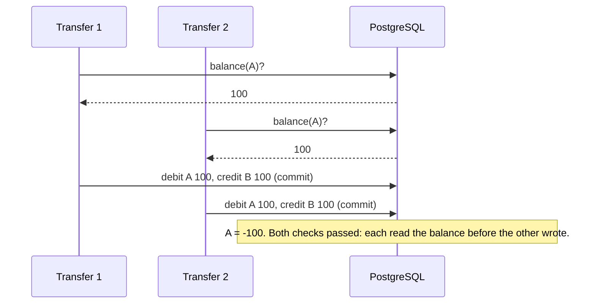
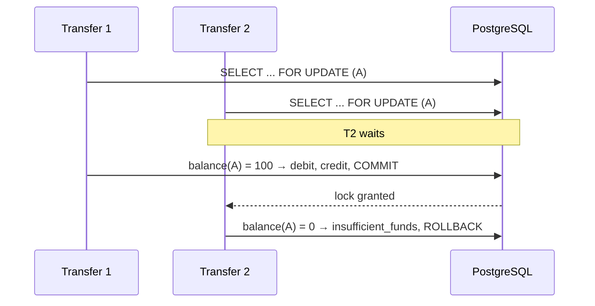
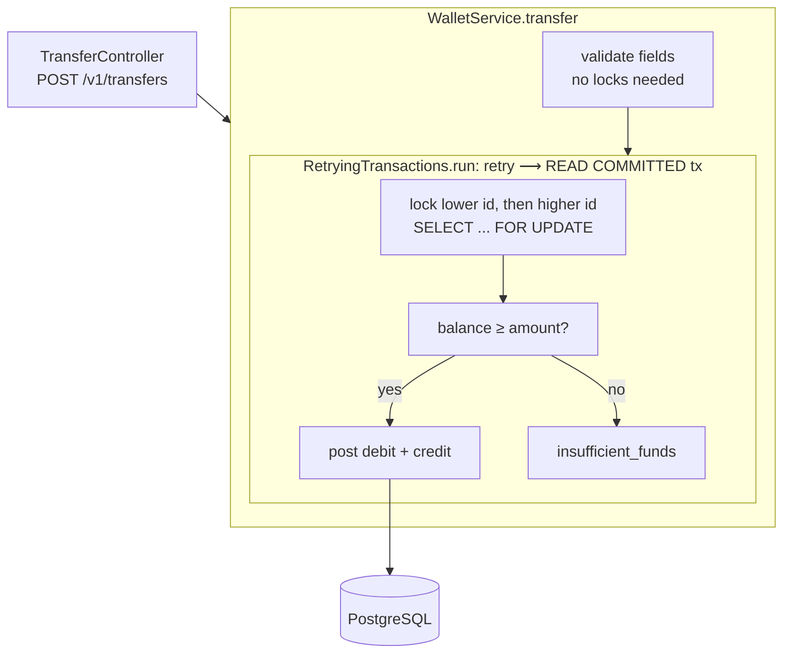

# Chapter 3 — Moving money safely

> **Branch:** `ch03-safe-transfers` · **Builds on:** [Chapter 2](02-double-entry-ledger.md) ·
> **Go reference:** `internal/wallet/transfer.go`, `internal/wallet/ledger.go` (`inTx`),
> `internal/platform/postgres/retry.go`

## What you'll learn

- The **check-then-act** race, and how it overdraws a wallet under concurrency
- Pessimistic locking with `SELECT ... FOR UPDATE`
- Deadlocks, and how **lock ordering** prevents them
- Why some database errors mean "try again", and how to retry a *whole* transaction safely
- Spring Framework 7's built-in `RetryTemplate`, with exponential backoff and jitter
- How to write a concurrency test that actually catches the bug

## The problem

A transfer has to check the balance before moving money:

```java
if (ledger.balance(from) < amount) throw insufficientFunds();
ledger.post("transfer", debit(from, amount), credit(to, amount));
```

Run that once and it is correct. Run it 30 times **at the same moment** against a wallet holding
1,000, with each transfer moving 100:



This is not a thought experiment. We ran `TransferConcurrencyIT` with the locks commented out:
**13 transfers succeeded instead of 10, leaving the wallet at −300.** Every individual line was
correct; the bug is between the lines.

The deferred balance trigger from chapter 2 doesn't help here: each transaction *is* balanced
(the debit equals the credit). The rule broken is "a wallet can't go below zero", which needs the
balance to stay the same between the check and the write.

## The concepts

### Pessimistic locking: `SELECT ... FOR UPDATE`

```sql
SELECT id FROM accounts WHERE id = :id FOR UPDATE
```

This locks the account's row until the transaction ends. A second transaction that tries to lock
the same row **waits** until the first commits or rolls back. If we lock the wallet *before*
reading its balance, the check and the write become atomic with respect to every other transfer
that also locks it:



Under PostgreSQL's default **READ COMMITTED** isolation, each statement sees everything committed
before it began, so after T2 gets the lock its balance query sees T1's entries. We set the isolation
level explicitly, so a different server default can't silently break this reasoning.

> **Why not optimistic locking (a `version` column)?** Optimistic locking suits rarely-contended
> rows: you detect a conflict at write time and retry. A popular wallet is *heavily* contended, so
> most attempts would be wasted. Also, our balance isn't a column to version: it's a sum. Locking
> the account row is the simplest correct tool here. Chapter 8 uses optimistic locking for saga
> state, where it fits.

### Deadlocks, and lock ordering

A transfer locks two wallets. Alice pays Bob while Bob pays Alice:


Neither can proceed. PostgreSQL detects the cycle after `deadlock_timeout` (1 s by default) and
kills one with error `40P01`. The fix is simple: **every transaction takes its locks in the same
global order** — here, the lower UUID first. Then T2 also tries Alice first, waits behind T1, and
no cycle can form.

```java
private void lockInOrder(UUID a, UUID b) {
    if (a.compareTo(b) > 0) { UUID swap = a; a = b; b = swap; }
    ledger.lock(a);
    ledger.lock(b);
}
```

Any fixed total order works. The Go reference compares UUID bytes; we use `UUID.compareTo`. What
matters is that *every* code path that locks two accounts uses the same order.

### Retrying a transaction (and only the right ones)

Even with careful ordering, PostgreSQL may abort a transaction because of a collision — a deadlock
involving some other code path, or a serialization failure (`40001`) under stricter isolation. Both
mean **nothing happened; it is safe to try again**. Spring translates both to subclasses of
`ConcurrencyFailureException`.

Two rules for retrying:

1. **Retry the whole transaction, never a statement inside it.** Once PostgreSQL aborts a
   transaction, every later statement in it fails. The retry must wrap the transaction boundary.
2. **Retry only transient errors.** An unbalanced transaction or insufficient funds will fail the
   same way every time; retrying just wastes work.

```java
@Component
public class RetryingTransactions {
    public RetryingTransactions(PlatformTransactionManager transactionManager) {
        this.transactions = new TransactionTemplate(transactionManager);
        this.transactions.setIsolationLevel(TransactionDefinition.ISOLATION_READ_COMMITTED);
        this.retry = new RetryTemplate(RetryPolicy.builder()
                .includes(ConcurrencyFailureException.class)
                .maxRetries(4)                    // 5 attempts in all
                .delay(Duration.ofMillis(10))
                .multiplier(2)                    // 10, 20, 40, 80 ms ...
                .jitter(Duration.ofMillis(5))     // ... ± a random amount
                .maxDelay(Duration.ofMillis(200))
                .build());
    }

    public <T> T run(Supplier<T> work) {
        return retry.invoke(() -> transactions.execute(status -> work.get()));
    }
}
```

`RetryTemplate` and `RetryPolicy` are new in **Spring Framework 7** (`org.springframework.core.retry`):
no extra dependency. **Jitter** matters: two transactions that just collided would otherwise retry
at exactly the same moment and collide again.

> **Why a `TransactionTemplate` instead of `@Transactional` + `@Retryable`?** Both annotations work
> through proxies, and the retry proxy must sit *outside* the transaction proxy. Getting that order
> right with annotations is possible but invisible. Here the nesting is right there in one line:
> retry, then transaction, then work.

## Architecture after this chapter



## Step by step

1. **`LedgerRepository.lock(id)`** — `SELECT id FROM accounts WHERE id = :id FOR UPDATE`, marked
   `Propagation.MANDATORY`: a lock outside a transaction would be released immediately.
2. **`RetryingTransactions`** — the retry-around-transaction helper above.
3. **`WalletService.transfer(from, to, amount)`**:
   - Validate *without* locks: parse ids, load both wallets, check different wallets, same currency,
     amount rules. Accounts never change owner or currency, so these reads can't go stale.
     Each problem is reported against its field (`from`, `to`, `currency`, `amount`).
   - Inside `transactions.run(...)`: `lockInOrder`, then the balance check, then `post`.
   - Insufficient funds is a `RuleViolationException` with code `insufficient_funds` → HTTP 422.
4. **`TransferController`** — `POST /v1/transfers` with
   `{"from", "to", "amount", "currency"}` → `201` with `transaction_id`, `from`, `to`, `amount`, `created_at`.

## Run it

```bash
docker compose up -d --wait
./mvnw -pl wallet-service spring-boot:run
```

Open two wallets, fund one, and transfer (the new requests are at the end of
[`api/wallet.http`](../api/wallet.http)):

```bash
curl -s -X POST localhost:8081/v1/transfers -H 'Content-Type: application/json' \
  -d '{"from":"<alice-wallet>","to":"<bob-wallet>","amount":300,"currency":"USD"}'
```

Watch a lock wait yourself, with two `psql` sessions:

```sql
-- session 1
BEGIN; SELECT id FROM accounts WHERE id = '<alice-wallet>' FOR UPDATE;
-- session 2: this blocks until session 1 ends
SELECT id FROM accounts WHERE id = '<alice-wallet>' FOR UPDATE;
-- session 1
COMMIT;   -- session 2 returns immediately
```

## Test it

```bash
./mvnw -pl wallet-service verify
```

| Test | What it proves |
|---|---|
| `RetryingTransactionsTest` | Retries a deadlock with a fresh transaction per attempt; gives up after 5; never retries other errors (unit test with a no-op transaction manager) |
| `WalletServiceTest` (new cases) | Field-level errors for bad wallets, same wallet, cross-currency; no posting when funds are short; **the lower id is locked first whichever way money flows** |
| `TransferConcurrencyIT` | 30 concurrent transfers of 100 from a 1,000 wallet: exactly 10 succeed, 20 get `insufficient_funds`, balances end at 0 and 1,000. 50 transfers in opposite directions at once: all succeed, no deadlock, no money lost |
| `TransferApiIT` | The HTTP contract, including the `insufficient_funds` code |

A good concurrency test **releases all threads at once** (a `CountDownLatch`), uses more threads
than the operation has room for, and asserts *exact* outcomes and conserved totals. Try it: comment
out `lockInOrder(...)` in `WalletService` and run `TransferConcurrencyIT`. It fails.

## How this connects

Chapter 2 made sure no transaction can be unbalanced. This chapter makes sure no *sequence* of
concurrent transactions can overdraw a wallet. One problem remains: if the client's connection
drops after we commit but before it reads our response, it doesn't know whether the transfer
happened. If it retries, the money moves twice. Chapter 4 fixes that with idempotency keys.

Later, in chapter 8, transfers between users move to their own service. The wallet keeps exactly
these locking rules for *holds*, the building block of that saga.

## Key takeaways

- Check-then-act on shared data is a race unless the check and the act are protected together.
- `SELECT ... FOR UPDATE` serialises access to a row for the rest of the transaction.
- Take multiple locks in one global order, and deadlocks become impossible.
- Retry only errors that mean "nothing happened", and retry the whole transaction, with backoff
  and jitter.
- Validate what can't change outside the lock; check what can change inside it. Keep the lock short.
- A concurrency test should fail when you remove the protection. Make sure it does.

## Exercises

1. Remove `lockInOrder` but keep the balance check, and run `TransferConcurrencyIT` a few times.
   How far below zero does the wallet go?
2. Keep the locks but always lock `from` first. Run the opposite-directions test and look for
   `deadlock detected` in the logs: the retry saves you, slowly. Time it against the ordered version.
3. Change the isolation level to `SERIALIZABLE` and remove the locks. Which errors do you get now,
   and does the retry handle them?

**Next:** [Chapter 4 — Idempotency keys](04-idempotency.md)
