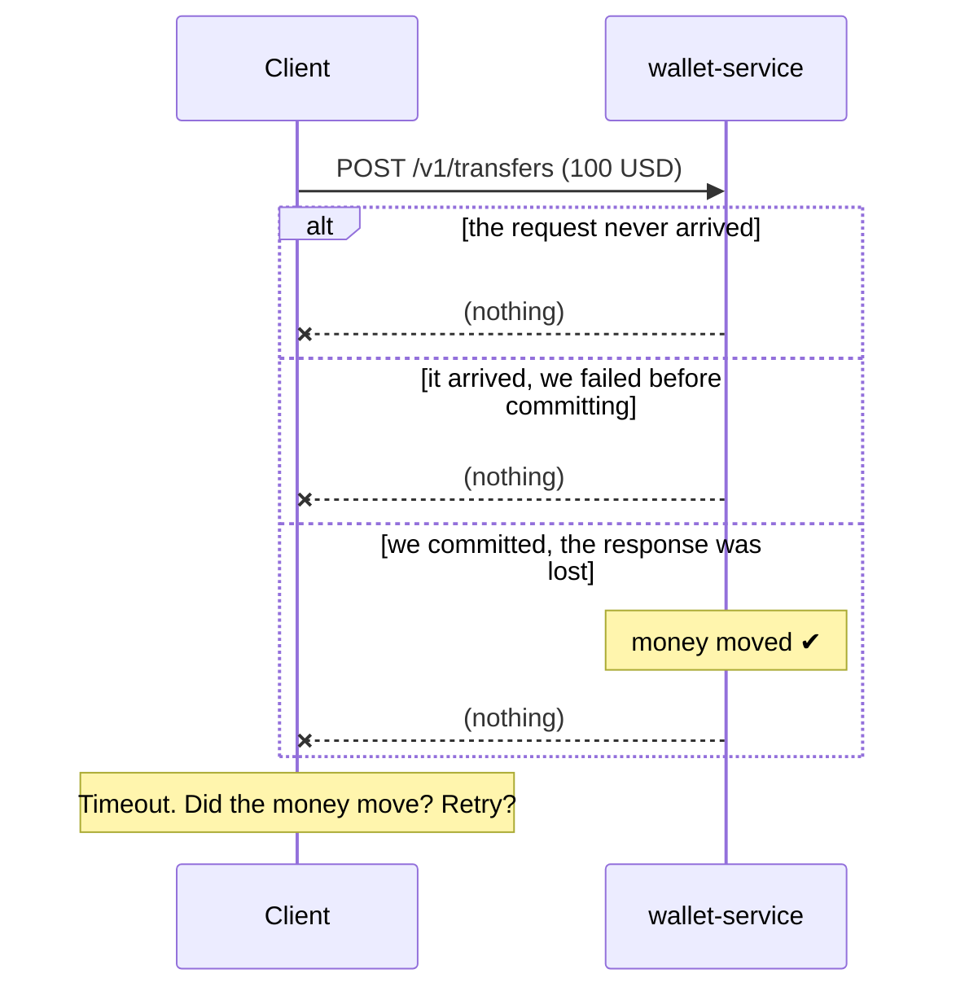
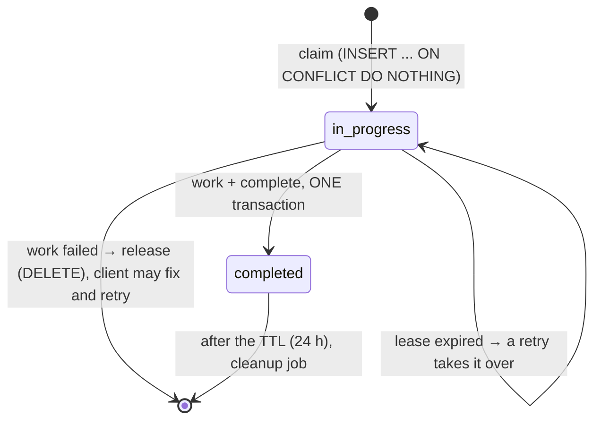
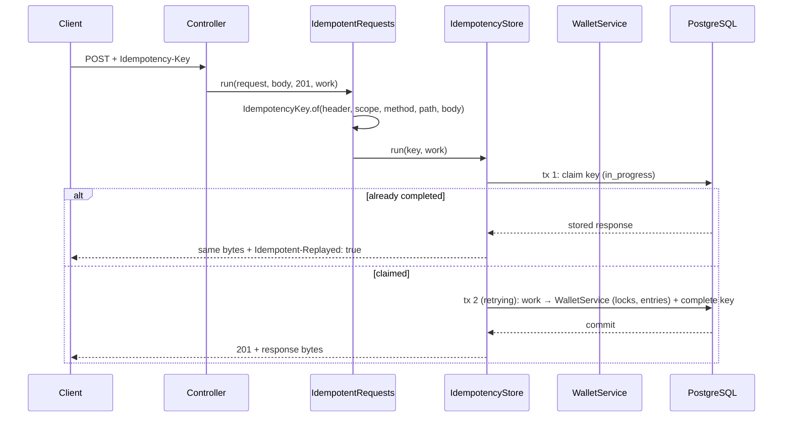

# Chapter 4 — Idempotency keys

> **Branch:** `ch04-idempotency` · **Builds on:** [Chapter 3](03-safe-transfers.md) ·
> **Go original:** `internal/platform/idempotency/{idempotency,store}.go`,
> `db/wallet/migrations/000003_idempotency_keys.up.sql`

## What you'll learn

- Why "exactly once" over a network is impossible, and what we build instead
- Idempotency keys: how Stripe, Adyen and every serious payments API make retries safe
- Request fingerprints, and why a reused key must match the original request
- How to store the response **in the same transaction** as the money movement
- Handling concurrent retries and crashed requests with claims and leases
- A subtle trap: retries nested inside someone else's transaction

## The problem

A client sends `POST /v1/transfers`. We lock, check, post, commit. Then the response is lost: a
mobile network drops, a load balancer times out, a pod restarts. From the client's side the three
cases look exactly the same:



If the client retries, case 3 moves the money **twice**. If it doesn't, cases 1 and 2 lose the
payment. Distributed systems can't guarantee exactly-once *delivery*. What we can guarantee is
**exactly-once *effect***: the client retries as often as it likes, and we make every retry after
the first a no-op that returns the first answer.

## The concept: idempotency keys

The client generates a unique key (a UUID) per *operation* and sends it with every attempt:

```http
POST /v1/transfers
Idempotency-Key: 6a1f2c3e-1b2c-4d5e-8f90-123456789abc
Content-Type: application/json

{"from": "...", "to": "...", "amount": 100, "currency": "USD"}
```

| Situation | Our answer |
|---|---|
| First time we see the key | Run it; store the response with the key |
| Same key, same request, already completed | Replay the stored response **byte for byte**, with `Idempotent-Replayed: true` |
| Same key, **different** request | `422 idempotency_key_reused` (a client bug) |
| Same key, still running in another request | `409 request_in_progress` — retry later |
| No key on a money-moving request | `400 idempotency_key_required` |

### The key's lifecycle



### The one rule that makes it correct

**The money movement and the "completed" marker commit in the same database transaction.**

```java
return transactions.run(() -> {
    StoredResponse response = work.get();   // e.g. wallets.transfer(...): locks, posts entries
    complete(key, response);                // UPDATE idempotency_keys SET status = 'completed', ...
    return response;
});
```

If we stored the key in Redis, or in another transaction, there would be a moment where money had
moved but the key didn't know — and a crash at that moment means a retry moves it again. With both
in one transaction, that moment doesn't exist. This is the payoff of keeping the idempotency table
in the **same database** as the ledger.

### Fingerprints

A client might reuse a key by mistake for a different request. Replaying the old response would
then lie to it. So each key stores a SHA-256 **fingerprint** of the method, path and *canonical*
body (the decoded body, encoded again by our own `JsonMapper`, so spaces and field order don't
matter, but any value does). A mismatch is `idempotency_key_reused`.

### Scope

Clients choose keys, so two clients may both send `"1"`. Keys are unique per **scope** — the
caller. Until chapter 6 there is no authenticated caller, so every request uses the scope
`anonymous`; once the gateway tells us who the user is, the scope becomes their user id.

### Concurrency: claims and leases

Two retries of the same request can arrive at once (an impatient client, or a proxy retrying).
The `INSERT ... ON CONFLICT DO NOTHING` on the primary key `(scope, key)` lets exactly one of them
claim the key; the other sees the existing row, locks it with `FOR UPDATE`, and gets
`409 request_in_progress`.

If the process holding a claim dies, its transaction never commits, and the key would be stuck
`in_progress` forever. So every claim records `locked_at`; a claim older than the **lease**
(1 minute) is considered abandoned, and the next retry takes it over. The `complete` step only
updates rows still `in_progress`, so even a slow original request that wakes up late can't
complete a key someone else completed: it rolls back instead.

## Architecture after this chapter



## Step by step

1. **Migration** — [`V3__idempotency_keys.sql`](../wallet-service/src/main/resources/db/migration/V3__idempotency_keys.sql):
   primary key `(scope, key)`; a `CHECK` that a completed key always has its response; an index
   on `expires_at` for cleanup.
2. **Configuration** — `wallet.idempotency.ttl: 24h` and `lease: 1m`, a new nested record in `WalletProperties`.
3. **Errors** — `IdempotencyException` with a `Reason` enum joins the sealed hierarchy. The
   compiler then made `ApiExceptionHandler` handle it: that is the sealed-class payoff from chapter 1.
4. **`IdempotencyKey`** — validates the header and computes the fingerprint.
5. **`IdempotencyStore`** — `claim` → (`existing`) → work + `complete` in one retrying transaction
   → `release` on failure. A port of the Go `Store`, without its optional Redis cache.
6. **`IdempotentRequests`** — the controller-facing helper. It serialises the work's result once,
   stores those exact bytes, and returns them as `ResponseEntity<byte[]>`, so the replay matches
   byte for byte.
7. **Controllers** — deposits and transfers now go through `idempotent.run(...)`:

   ```java
   @PostMapping("/{id}/deposits")
   ResponseEntity<byte[]> deposit(@PathVariable String id, @RequestBody Money amount, HttpServletRequest request) {
       UUID walletId = walletId(id);
       return idempotent.run(request, amount, HttpStatus.CREATED, () -> {
           Transaction tx = wallets.deposit(walletId, amount);
           return new DepositResponse(tx.id(), walletId, amount, tx.createdAt());
       });
   }
   ```

8. **Cleanup** — `IdempotencyCleanup`, an `@Scheduled` job (hourly) that deletes expired keys.
   `@EnableScheduling` goes on `WalletApplication`. Every instance runs it; deleting rows that are
   already gone is harmless.

### The nested-retry trap

`WalletService.transfer` already runs in `RetryingTransactions.run(...)` (chapter 3). Now it is
called from *inside* the idempotency transaction. If the inner call opened its own retry loop, a
deadlock would abort the **outer** transaction, and the inner loop would retry statements inside
an aborted transaction — they would all fail.

The fix: only the outermost caller owns the transaction, so only it may retry.

```java
public <T> T run(Supplier<T> work) {
    if (TransactionSynchronizationManager.isActualTransactionActive()) {
        return work.get();          // join the caller's transaction; the caller retries
    }
    return retry.invoke(() -> transactions.execute(status -> work.get()));
}
```

The Go original does the same thing: a store bound to a caller's transaction "just joins it".

## Run it

```bash
docker compose up -d --wait
./mvnw -pl wallet-service spring-boot:run
```

Send the same deposit twice with the same key (or use [`api/wallet.http`](../api/wallet.http)):

```bash
curl -si -X POST localhost:8081/v1/wallets/<id>/deposits \
  -H 'Content-Type: application/json' -H 'Idempotency-Key: demo-1' \
  -d '{"amount":1050,"currency":"USD"}'
```

The second response has `Idempotent-Replayed: true` and the same body, and the balance only grew once.
Change the amount and keep the key: `422 idempotency_key_reused`. Drop the header: `400 idempotency_key_required`.

## Test it

| Test | What it proves |
|---|---|
| `IdempotencyKeyTest` | Same request ⇒ same fingerprint; method, path, amount or currency changes it; header required, ≤ 255 chars |
| `RetryingTransactionsTest` (new case) | Inside an existing transaction it joins and never retries |
| `IdempotencyIT` | A retry replays byte for byte and moves no money; a reused key is refused; a key is required; a failed request releases its key; an abandoned claim is taken over; a fresh claim makes retries wait; **10 concurrent retries credit the wallet exactly once** |

`WalletApiIT` and `TransferApiIT` now send an `Idempotency-Key` with every deposit and transfer.

## How this connects

Chapters 2–3 made each money movement correct. This chapter makes it correct *when repeated*,
which is the normal case over a network. The same idea comes back three times later in the course:

- **Chapter 7:** events are delivered *at least once*, so consumers must be idempotent.
- **Chapter 8:** the transfer saga retries calls to the wallet; each call carries a key (the hold id).
- **Chapter 9:** the notification consumer deduplicates by event id.

This also completes the wallet as a standalone service. In chapter 5 we build a second service.

## Key takeaways

- Exactly-once delivery is impossible; exactly-once **effect** is achievable with idempotency keys.
- Store the response with the key, in the **same transaction** as the side effect.
- Fingerprint the request; a reused key with a different body is a client error, not a replay.
- Claims with leases handle both concurrent retries and crashed requests.
- Release the key when the work fails, so the client can fix and resend.
- Only the outermost owner of a transaction retries it.

## Exercises

1. Add the Go original's Redis fast path: cache completed responses for a few minutes and check
   the cache before claiming. What happens if Redis is down? (It must only be an optimisation.)
2. Make `IdempotencyCleanup` delete in batches of 1,000 so it never holds a long lock.
3. Write a test where the client retries *while* the first request is blocked on a wallet lock.
   Which status does the retry get?

**Next:** [Chapter 5 — The auth service](05-auth-service.md)
