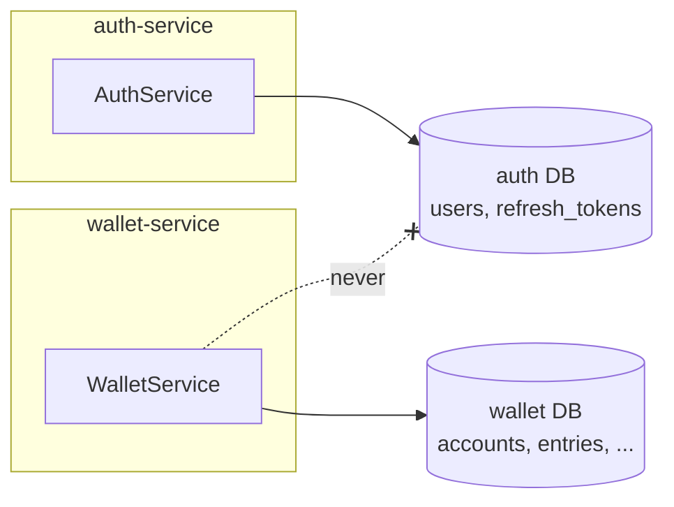
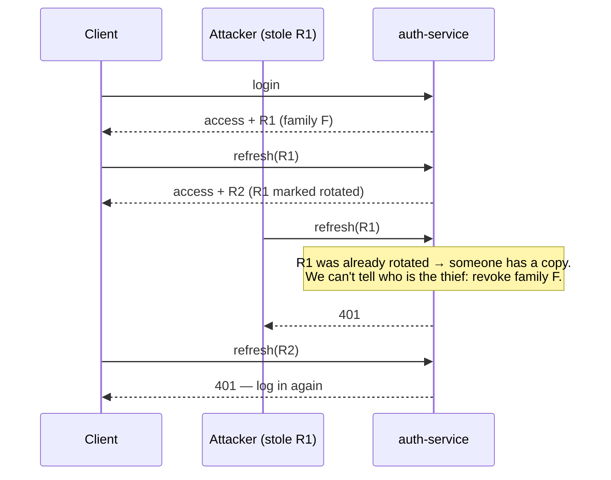
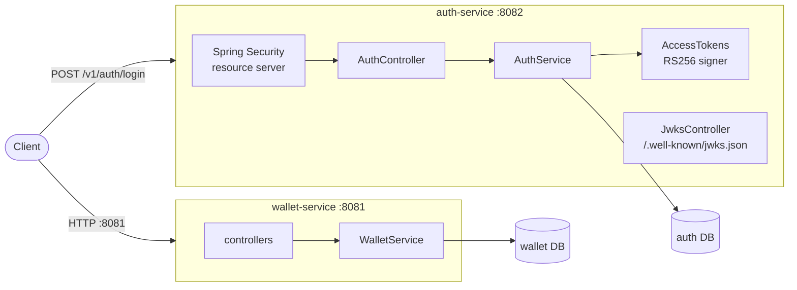

# Chapter 5 — The auth service

> **Branch:** `ch05-auth-service` · **Builds on:** [Chapter 4](04-idempotency.md) ·
> **Go original:** `internal/auth/{service,tokens,password,http}.go`, `db/auth/migrations/00000{1,2}_*.up.sql`

## What you'll learn

- How to decide **where to split** a system into services, and why auth is a classic first split
- **Database per service**: what it means, why it matters, what it costs
- Password storage done right: argon2id, constant-time behaviour, no user enumeration
- Access tokens vs refresh tokens, and why you need both
- Signing JWTs with an asymmetric key (RS256) and publishing the public key as a **JWKS**
- Refresh token **rotation with reuse detection**
- Spring Security as a stateless OAuth 2 resource server

## The problem

So far the wallet trusts whatever `owner_id` a client sends. Anyone can open a wallet for anyone,
and read anyone's balance. We need to know **who** is calling.

We could add users and passwords to the wallet service. We won't, and the reasons are the heart of
this chapter.

## The concept: why a separate service?

A service boundary is worth its cost (a network hop, a second deployable, data you can't `JOIN`)
when the two sides differ in ways that matter:

| | Wallet | Auth |
|---|---|---|
| Data | Accounts, ledger entries | Users, password hashes, refresh tokens |
| Sensitivity | Money | Credentials — a breach is catastrophic and permanent |
| Load profile | Short, locking transactions | Deliberately **slow** password hashing (argon2 uses CPU and memory by design) |
| Change rate | Business rules evolve | Rarely changes, but must be patched fast |
| Who may touch it | Payments team | Security-reviewed changes only |

Different data, different risks, different scaling: a good boundary. A login spike burning CPU on
argon2 must not slow down transfers, and a SQL injection in the wallet must not expose password
hashes.

### Database per service



Each service owns its database. **No other service reads or writes it** — not even "just one
query". If the wallet needs something from auth, it asks auth's API. This is what lets each service
change its schema, scale, or be rewritten without coordinating with the others. The price: no
cross-service joins or transactions. Chapter 8 deals with that price.

Locally both databases live on one Postgres server to save memory; the rule is about *ownership*,
not hardware.

### Access tokens and refresh tokens

| | Access token | Refresh token |
|---|---|---|
| Format | JWT, signed | 256 random bits, opaque |
| Lifetime | 15 minutes | 30 days |
| Sent with | Every API request | Only to `/v1/auth/refresh` |
| Verified by | Anyone with the **public key**, offline | Only the auth service, against its database |
| Revocable | No (it just expires) | Yes |

Access tokens are cheap to check — no database, no network call — which is exactly what a gateway
handling every request needs (chapter 6). The price is that they can't be revoked, so they must be
short-lived. Refresh tokens keep the session going and *can* be revoked, because only auth checks
them.

### Asymmetric signing and JWKS

We sign with an **RSA private key** (RS256) that never leaves the auth service, and publish the
**public key** at `/.well-known/jwks.json`:

```json
{"keys": [{"kty": "RSA", "use": "sig", "kid": "8J1yV4yE...", "e": "AQAB", "n": "..."}]}
```

With a shared secret (HS256), every service that *verifies* tokens could also *forge* them. With
RS256, verifiers hold only the public half. The `kid` (the key's thumbprint) in each token's header
says which key signed it, so keys can be rotated: publish old and new, sign with new, drop old once
its tokens expire.

> **Go original difference:** the Go code signs with Ed25519 (EdDSA). We use RS256 because Spring
> Security and the JDK support it natively without extra crypto libraries. The design is the same.

### Refresh token rotation and reuse detection



Each refresh token works **once**. A login starts a *family*; each refresh adds a token and marks
its parent rotated. If a rotated token comes back, two parties hold copies, so we revoke the whole
family. The revocation must **commit even though the request fails** — so the transaction returns
an outcome (`Issued`, `Invalid`, `Reused`) and the exception is thrown *after* commit.

We store only SHA-256 of each refresh token: a leaked table holds no working tokens.

### Passwords

- **argon2id** (`Argon2PasswordEncoder.defaultsForSpringSecurity_v5_8()`): memory-hard, so GPU
  guessing is expensive. The stored string carries its own salt and parameters.
- **Length is the rule**: 12–128 characters, no "must contain a digit" rules (they make passwords
  shorter and more predictable, per NIST SP 800-63B).
- **No user enumeration**: a wrong password and an unknown email return the identical `401`, and
  take the same time — for an unknown email we still verify against a dummy hash.
- **Emails are case-insensitive**: the column is `citext`, so `Alice@Example.com` and
  `alice@example.com` are one user.

## Architecture after this chapter



The two services don't talk to each other yet. In chapter 6 the gateway fetches the JWKS, checks
tokens, and tells the wallet who the caller is.

## Step by step

1. **New module** — `auth-service/` with its own [`pom.xml`](../auth-service/pom.xml), added to the
   parent's `<modules>`. New dependencies: `spring-boot-starter-security`,
   `spring-boot-starter-oauth2-resource-server` (brings Nimbus JOSE for signing and verifying JWTs),
   and BouncyCastle (`bcprov-jdk18on`) for Argon2, version pinned in the parent pom.
2. **Its own database** — `CREATE DATABASE auth;` in [`deploy/postgres/01-create-databases.sql`](../deploy/postgres/01-create-databases.sql),
   and `V1__users.sql`, `V2__refresh_tokens.sql` ported from Go.
3. **Infrastructure, copied** — `error/*`, `web/ApiExceptionHandler`, `web/RequestIdFilter` are
   copies of the wallet's, with `UnauthenticatedException` (401) added and `RuleViolationException`
   dropped. Chapter 1 explained why we copy rather than share a library.
4. **Configuration** — [`AuthProperties`](../auth-service/src/main/java/dev/payments/auth/AuthProperties.java):
   issuer, audience, both TTLs, and the private key location.
5. **Keys** — `token/SigningKeyConfig` loads a PKCS #8 PEM key (`scripts/dev-keys.sh` makes one) or,
   if none is configured, generates a throwaway key and logs a warning. It builds an `RSAKey` with a
   thumbprint `kid`, a `NimbusJwtEncoder`, and a `NimbusJwtDecoder` that validates signature,
   expiry, issuer and audience.
6. **Tokens** — `token/AccessTokens` issues JWTs; `token/JwksController` publishes the public key.
7. **Users and sessions** — `user/UserRepository`, `user/RefreshTokenRepository` (`FOR UPDATE` on
   refresh, so two refreshes with one token take turns), and `user/AuthService`.
8. **API** — `user/AuthController`:

   | Method | Path | Body | Success |
   |---|---|---|---|
   | `POST` | `/v1/auth/register` | `{"email", "password"}` | `201` user |
   | `POST` | `/v1/auth/login` | `{"email", "password"}` | `200` `{"access_token", "token_type": "Bearer", "expires_in", "refresh_token"}` |
   | `POST` | `/v1/auth/refresh` | `{"refresh_token"}` | `200` new pair |
   | `POST` | `/v1/auth/logout` | `{"refresh_token"}` | `204` |
   | `GET` | `/v1/auth/me` | — (Bearer token) | `200` user |
   | `GET` | `/.well-known/jwks.json` | — | `200` public keys |

9. **Security** — `security/SecurityConfig`: stateless, CSRF off (no cookies, nothing to forge),
   `/v1/auth/me` authenticated, everything else public, JWT resource server.
   `web/ProblemAuthenticationEntryPoint` makes 401s use our Problem Details shape: Spring Security
   rejects requests in a *filter*, before `@RestControllerAdvice` can see them.

## Run it

```bash
docker compose down -v          # the init script only runs on a fresh volume: recreate it for the auth DB
docker compose up -d --wait
./scripts/dev-keys.sh            # writes secrets/auth-signing-key.pem (git-ignored)
./mvnw -pl auth-service spring-boot:run -Dspring-boot.run.arguments=--auth.private-key-location=file:../secrets/auth-signing-key.pem
```

Then send [`api/auth.http`](../api/auth.http): register, log in, `GET /v1/auth/me` with the access
token, refresh. Paste the access token into [jwt.io](https://jwt.io) to read its claims (never paste
a production token anywhere).

## Test it

| Test | What it proves |
|---|---|
| `AccessTokensTest` | Claims (`sub`, `iss`, `aud`, `jti`, `kid`, 15-minute life); expired, foreign-key and wrong-audience tokens are rejected; the JWKS has no private parts |
| `AuthApiIT` | Register, login, `/me`; case-insensitive uniqueness; field errors; wrong password ≡ unknown email (byte-identical apart from the request id); 401 Problem Details with `WWW-Authenticate: Bearer`; rotation and family revocation on reuse; logout; a token verifies against the published JWKS |

## How this connects

The wallet still trusts `owner_id` from the request body — on purpose, for one more chapter.
Chapter 6 adds the gateway: it verifies access tokens with this service's JWKS, then passes the
user id to the wallet, which stops trusting the body. Chapter 9's notification service will ask
auth for a user's email — through its API, never its database.

## Key takeaways

- Split services along real differences: data, risk, load, ownership. Auth is a textbook case.
- Database per service: a service's tables are private. Ask the API.
- Hash passwords with argon2id; avoid revealing which emails exist, in content *and* timing.
- Short-lived, offline-verifiable access tokens + revocable, rotating refresh tokens.
- Sign with a private key, publish the public key as a JWKS, identify keys by `kid`.
- When a failure must still be recorded, commit first, then throw.

## Exercises

1. Add roles: a `roles text[]` column, a `roles` claim, and an endpoint only an `admin` may call.
2. Support key rotation: load two keys, sign with the newest, publish both in the JWKS.
3. Add a "log out everywhere" endpoint that revokes every family of the current user.
4. Rate-limit `/v1/auth/login` per email. (Chapter 6 adds rate limiting at the gateway; think about
   why per-email limits belong here instead.)

**Next:** [Chapter 6 — The API gateway](06-api-gateway.md)
