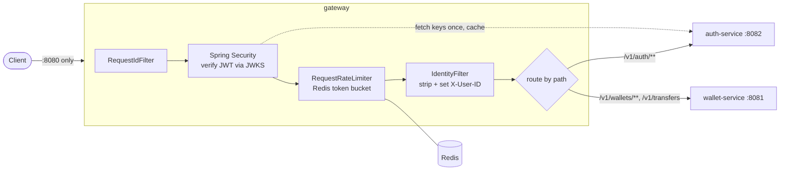

# Chapter 6 — The API gateway

> **Branch:** `ch06-api-gateway` · **Builds on:** [Chapter 5](05-auth-service.md) ·
> **Go reference:** `internal/gateway/{gateway,proxy,ratelimit,cors}.go`, `internal/platform/authn`

## What you'll learn

- The API gateway pattern: one front door for many services
- **Authentication at the edge**: verifying JWTs once, offline, with a JWKS
- **Identity propagation**: telling services who the caller is, and why the gateway must strip
  spoofed headers
- Authorization in the service: ownership checks, and "not found" instead of "forbidden"
- Distributed rate limiting with a token bucket in Redis
- CORS, timeouts and request IDs at the edge
- Spring Cloud Gateway (WebFlux): routes, predicates, filters, and why it is reactive

## The problem

We have two services on two ports. A client would need to know both addresses, and each service
would have to check tokens itself, configure CORS itself, limit abuse itself. Worse, the wallet
still trusts `owner_id` from the request body: anyone can open a wallet for anyone.

Every new service would repeat all of that. Cross-cutting concerns belong in one place.

## The concept: an API gateway



The gateway is the **only** public entry point. It does the things every request needs and that no
service should have to repeat, and **nothing else**: no business rules, no database. A gateway that
grows business logic becomes a distributed monolith's bottleneck.

### Authentication at the edge, authorization in the service

The gateway answers **"who are you?"** — it verifies the access token (signature, expiry, issuer,
audience) using the public keys from the auth service's JWKS, fetched once and cached. No call to
auth per request.

The wallet answers **"may you do this?"** — only the wallet knows who owns a wallet. These are
different questions, asked in different places:

```java
public Account wallet(UUID caller, UUID id) {
    return ledger.findAccount(id)
            .filter(Account::isWallet)
            .filter(a -> caller.equals(a.ownerId()))
            .orElseThrow(() -> new NotFoundException("wallet not found"));
}
```

Someone else's wallet is **404, not 403**: a 403 would confirm that the id exists.

### Identity propagation, and the spoofing trap

After verifying the token, the gateway tells the service who the caller is with a header:

```
X-User-ID: 79f6a6bf-2b9d-45e0-9ee8-fd270aba66bf
```

The wallet trusts that header — so **the gateway must delete any `X-User-ID` the client sent**
before setting its own. Forget that one line and anyone can be anyone:

```java
.request(r -> r.headers(h -> {
    h.remove(USER_HEADER);                          // never trust the client's copy
    user.ifPresent(id -> h.set(USER_HEADER, id));   // the verified token's subject
}))
```

The wallet's trust also depends on a **network rule**: only the gateway can reach it. In Compose
and Kubernetes that's network configuration (chapter 12 stops publishing the wallet's port); with
mTLS between services it becomes cryptographic (a follow-up topic, Go episode 21).

> **Why a header and not forward the JWT?** Forwarding the token and re-verifying in every service
> is also valid ("zero trust"), and more robust if the network rule fails. It costs a JWKS client and
> a verification in every service. We choose the simpler header here and say so out loud; the
> auth service's own `/v1/auth/me` still verifies the token itself.

### Rate limiting: a token bucket in Redis

Each user (or, before login, each IP address) has a bucket of `burstCapacity` tokens, refilled at
`replenishRate` tokens per second. A request takes one token; an empty bucket means
`429 Too Many Requests`. The buckets live in **Redis**, so three gateway instances share one budget
per user instead of granting three times the limit. Spring Cloud Gateway's `RedisRateLimiter`
implements this with an atomic Lua script.

### Why a reactive gateway?

Spring Cloud Gateway comes in two flavours: **WebFlux** (Netty, non-blocking) and **Server WebMVC**
(servlet). A gateway spends almost all its time *waiting* for downstream services. On WebFlux, a
waiting request holds no thread, so one instance can keep thousands of slow calls in flight. It also
has Redis rate limiting built in. Our *services* stay on Spring MVC: their work is database-bound
and blocking code is simpler to read and debug. Use reactive where it pays.

## Step by step

### 1. Spring Cloud on the build

The parent pom imports the **`spring-cloud-dependencies` 2026.0.0** BOM, the release train built
for Spring Boot 4.2. Mismatched Boot and Cloud versions are the most common Spring Cloud problem;
always pick the train the Spring Cloud docs list for your Boot version.

### 2. The gateway module

[`gateway/pom.xml`](../gateway/pom.xml): `spring-cloud-starter-gateway-server-webflux`,
`spring-boot-starter-security`, `spring-boot-starter-oauth2-resource-server`,
`spring-boot-starter-data-redis-reactive`, actuator.

### 3. Routes, in configuration

```yaml
spring.cloud.gateway.server.webflux:
  httpclient:
    connect-timeout: 1000
    response-timeout: 5s
  default-filters:
    - name: RequestRateLimiter
      args:
        key-resolver: "#{@userOrIpKeyResolver}"
        redis-rate-limiter.replenishRate: ${gateway.rate-limit.replenish-rate:10}
        redis-rate-limiter.burstCapacity: ${gateway.rate-limit.burst-capacity:20}
  routes:
    - id: auth
      uri: ${gateway.services.auth:http://localhost:8082}
      predicates: [Path=/v1/auth/**]
    - id: wallet
      uri: ${gateway.services.wallet:http://localhost:8081}
      predicates: [Path=/v1/wallets/**,/v1/transfers/**,/v1/transfers]
```

A route is **predicates** (which requests) + **filters** (what to do on the way) + a **uri** (where
to send it). Anything matching no route is a 404 at the gateway; `/internal/**` endpoints that later
chapters add are therefore unreachable from outside by construction.

### 4. Security

[`SecurityConfig`](../gateway/src/main/java/dev/payments/gateway/SecurityConfig.java): register,
login, refresh, logout and health are public; everything else requires a valid JWT. The
`NimbusReactiveJwtDecoder` uses the JWKS URI and validates issuer and audience, exactly like the
auth service's own decoder. `ProblemEntryPoint` returns 401s in our Problem Details shape.

### 5. Filters

- `RequestIdFilter` (a `WebFilter`, first of all): every request gets an `X-Request-ID`, passed
  downstream, so the wallet's logs carry the same id as the gateway's.
- `IdentityFilter` (a gateway `GlobalFilter`): strip, then set `X-User-ID`.
- `RateLimitConfig`: the `KeyResolver` — `user:<sub>` or `ip:<address>`.

### 6. CORS

A `CorsConfigurationSource` bean allows the origins in `gateway.allowed-origins`
(`http://localhost:3000` by default), and Spring Security answers preflight `OPTIONS` requests before
authentication runs. Only the gateway does CORS: services are never called from browsers.

### 7. The wallet stops trusting the body

- `web/Caller` + `web/CallerArgumentResolver`: a controller declares a `Caller` parameter and gets the
  user from `X-User-ID`; no header ⇒ `401 unauthenticated` (the request didn't come through the gateway).
- `CreateWalletRequest` loses `owner_id`; the owner is the caller.
- `WalletService` methods take the caller: wallets, balances, entries and deposits are owner-only;
  a transfer's `from` must be the caller's, its `to` may be anyone's.
- Idempotency keys are now scoped **per user**, finishing what chapter 4 started.

## Run it

```bash
docker compose up -d --wait            # PostgreSQL and, new, Redis
./scripts/dev-keys.sh
./mvnw -q install -DskipTests
java -jar auth-service/target/auth-service-1.0.0-SNAPSHOT.jar --auth.private-key-location=file:secrets/auth-signing-key.pem &
java -jar wallet-service/target/wallet-service-1.0.0-SNAPSHOT.jar &
java -jar gateway/target/gateway-1.0.0-SNAPSHOT.jar &
```

Then follow [`api/gateway.http`](../api/gateway.http): register → login → open a wallet → deposit →
balance, all on port 8080. Try a request without the `Authorization` header (401), and one with a
forged `X-User-ID` header (it is ignored).

We ran exactly this flow while writing the chapter: the wallet's `owner_id` came back equal to the
auth service's user id, and unauthenticated or spoofed requests got 401.

## Test it

| Test | What it proves |
|---|---|
| `GatewayIT` | Public routes pass without a token; others need one (401 Problem Details); the verified subject reaches the service as `X-User-ID`; **a spoofed `X-User-ID` is replaced or removed**; expired, foreign-key, wrong-audience and malformed tokens are refused; per-user rate limits return 429 and don't affect other users; request ids are generated and forwarded; CORS preflights allow only configured origins |
| `WalletApiIT` (updated) | Owner comes from the header, not the body; no header ⇒ 401; other people's wallets ⇒ 404 on every endpoint |
| `WalletServiceTest` (new cases) | Ownership rules, including "money leaves only your own wallets" |
| `IdempotencyIT` (new case) | Two users may use the same key |

`GatewayIT` needs no real auth or wallet service. `FakeServices` uses the JDK's built-in
`HttpServer` to serve a JWKS (with a key the test signs tokens with) and to echo every request it
receives — so the test can see exactly which headers arrived downstream. Redis runs in a
Testcontainers `GenericContainer` with `@ServiceConnection(name = "redis")`.

## How this connects

Chapters 1–4 built a correct service; chapter 5 built identity; this chapter connects them behind
one front door. From now on, **every external request enters through the gateway**, and each new
service in later chapters is one more route. In chapter 8, `/v1/transfers` moves to a new transfer
service — a one-line route change that clients never notice. That's the gateway's other big
benefit: it hides the internal layout.

## Key takeaways

- A gateway centralises cross-cutting concerns: authentication, rate limits, CORS, timeouts, request ids.
- Keep business logic out of it.
- Authenticate at the edge; authorize where the data lives.
- If services trust an identity header, the gateway **must** strip client-sent copies, and only the
  gateway may reach the services.
- Use 404, not 403, for resources the caller may not know exist.
- Distributed rate limits need shared state: Redis token buckets.
- Choose reactive for I/O-bound edge components; keep services simple.

## Exercises

1. Make the 429 response a Problem Details body with `code: rate_limited` and a `Retry-After` header.
2. Give `/v1/auth/login` a stricter limit than the rest (a route-level `RequestRateLimiter`).
3. Switch to "forward the JWT" propagation: the wallet becomes a resource server too. What changes,
   and what do you gain?
4. Stop the auth service after the gateway has fetched the JWKS once. Do requests still work? Why?

**Next:** [Chapter 7 — Events and the outbox](07-events-outbox.md)
