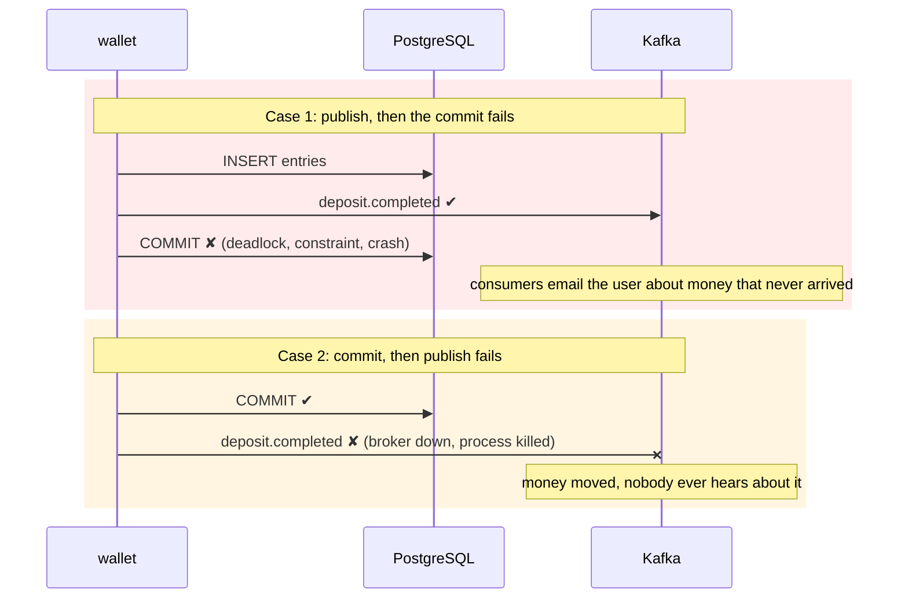
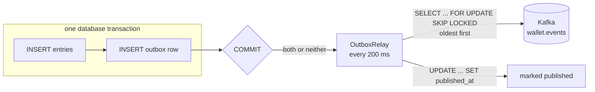

# Chapter 7 — Events and the outbox

> **Branch:** `ch07-events-outbox` · **Builds on:** [Chapter 6](06-api-gateway.md) ·
> **Go original:** `db/wallet/migrations/000004_outbox.up.sql`, `internal/wallet/events.go`,
> `internal/wallet/walletevents/events.go`, `internal/platform/outbox/relay.go`

## What you'll learn

- Synchronous vs asynchronous communication between services, and when to use each
- Events as a contract: naming, versioning, envelopes
- The **dual-write problem**, and why "save, then publish" loses or invents events
- The **transactional outbox** pattern, and its at-least-once guarantee
- Kafka essentials: topics, partitions, keys, ordering, acks and idempotent producers
- `FOR UPDATE SKIP LOCKED`: a work queue in PostgreSQL
- Testing asynchronous flows with Testcontainers Kafka and Awaitility

## The problem

Soon other services need to know what happens in the wallet: the notification service (chapter 9)
emails people when money arrives, and later webhooks, fraud checks and reports would too.

The wallet could **call** each of them after every deposit. Then the wallet must know about all of
them, wait for all of them, and fail when any of them is down. Every new consumer means changing the
wallet. That's coupling in time (all must be up) and in knowledge (the producer knows its consumers).

### Commands and events

| | Synchronous call (command) | Event |
|---|---|---|
| Says | "Do this" | "This happened" |
| Producer knows the consumer | Yes | No |
| Both must be up | Yes | No: the broker holds events |
| Producer waits | Yes | No |
| Good for | You need the answer now (chapter 8: "hold this money") | Others should react eventually (send an email) |

The wallet publishes **events** — `deposit.completed`, `transfer.completed` — to Kafka, and anyone
interested subscribes. Adding a consumer changes nothing in the wallet.

### The dual-write problem

The naive implementation writes to two systems, and there is no transaction spanning both:

```java
@Transactional
public Transaction deposit(...) {
    Transaction tx = ledger.post(...);
    kafka.send("wallet.events", depositCompleted(tx));   // ❌
    return tx;
}
```



Reordering doesn't help; it just swaps which failure you get.

## The concept: the transactional outbox

Write the event to **the same database, in the same transaction** as the change. A separate
**relay** then copies it to Kafka.



Now the event exists **if and only if** the change committed. The relay can crash at any point:

| Crash between… | Result |
|---|---|
| commit and publish | Row still unpublished; the next poll publishes it. **No event lost.** |
| publish and marking it published | The next poll publishes it **again**. A duplicate. |

So the outbox gives **at-least-once** delivery: never lost, occasionally duplicated. Every event
carries a unique `id`, and consumers drop the ones they've already processed (chapter 9 builds
exactly that). This is the same deal as chapter 4's idempotency keys, from the other side.

### Kafka in five ideas

- A **topic** is a named, append-only log: `wallet.events`.
- A topic is split into **partitions** (we use 3). Partitions are the unit of parallelism: consumers
  in a group divide them.
- **Order is guaranteed only within a partition.** The message **key** picks the partition. We key
  every event by its wallet id, so all events of one wallet land in one partition, in order.
- Consumers track their own position (**offset**); events stay for the retention period whether
  read or not, so a new consumer can replay history.
- `acks=all` + `enable.idempotence=true`: the producer waits for all in-sync replicas, and its own
  retries don't create duplicates.

> **Go original difference:** the Go system uses NATS JetStream, which deduplicates by message id
> at the broker. Kafka's idempotent producer only deduplicates the producer's own retries within a
> session, so after a relay crash Kafka *will* store a duplicate. Consumer-side deduplication by
> event id (chapter 9) handles it.

### The event contract

```json
{
  "id": "dfc6b7df-e3cd-4a2c-b1c9-60a6b71d0ac3",
  "type": "wallet.deposit.completed.v1",
  "occurred_at": "2026-11-24T17:13:54.410788Z",
  "aggregate_id": "a6a24aa3-d842-4df8-8ce3-4f73625f8a87",
  "data": {
    "transaction_id": "a2f11026-8457-4a72-8f92-525d7d8096cc",
    "wallet": {"id": "a6a24aa3-...", "owner_id": "7d3c5a8e-...", "currency": "USD"},
    "amount": 1050
  }
}
```

| Type | When | `data` |
|---|---|---|
| `wallet.wallet.created.v1` | A wallet opened | `wallet` |
| `wallet.deposit.completed.v1` | Money arrived from outside | `transaction_id`, `wallet`, `amount` |
| `wallet.transfer.completed.v1` | Money moved between wallets (keyed by the sender) | `transaction_id`, `from`, `to`, `amount` |

Rules: the **type** names the service, the fact (past tense) and a **version**. Adding a field is
fine (consumers ignore what they don't know). Removing or changing a field is a **new version**,
published alongside the old one until consumers move. Events carry the data consumers need (the
owner, the currency), so they don't have to call back to the wallet.

> **Share the contract, not a library.** Consumers define their own small records for the fields
> they read ("tolerant reader"). A shared `wallet-events.jar` would couple every consumer's
> release to the wallet's.

## Step by step

1. **Kafka in Compose** — `apache/kafka:4.2.2` in KRaft mode (no ZooKeeper), with topic
   auto-creation **off**: services create the topics they own.
2. **Dependencies** — `spring-boot-starter-kafka`; for tests `testcontainers-kafka` and `awaitility`.
3. **Migration** — [`V4__outbox.sql`](../wallet-service/src/main/resources/db/migration/V4__outbox.sql):
   `seq` (publish order), `event_id`, `topic`, `message_key`, `payload json` (keeps our bytes
   exactly), `published_at`, and a **partial index** on unpublished rows so the relay's query stays
   fast however large the table grows.
4. **The contract** — [`events/WalletEvents`](../wallet-service/src/main/java/dev/payments/wallet/events/WalletEvents.java):
   type constants and records for the envelope and each event's data.
5. **The writer** — `events/Outbox.enqueue(type, walletId, data)`, with
   `Propagation.MANDATORY`: an event outside a transaction would defeat the point.
6. **Emit events** — `WalletService` enqueues `wallet.created` in `createWallet`,
   `deposit.completed` in `deposit`, `transfer.completed` inside the transfer's locked transaction.
7. **The relay** — `events/OutboxRelay`, an `@Scheduled` job every 200 ms:

   ```java
   SELECT seq, event_id, topic, message_key, payload::text FROM outbox
   WHERE published_at IS NULL ORDER BY seq LIMIT :limit
   FOR UPDATE SKIP LOCKED
   ```

   `FOR UPDATE` locks the batch until the relay commits; `SKIP LOCKED` lets another wallet instance's
   relay skip those rows and take the next ones instead of waiting. Each send waits for Kafka's
   acknowledgement (`.get(10, SECONDS)`). The first failure **stops the batch**, so no event overtakes
   an earlier one; what was sent is marked published. A second job deletes published rows after 7 days.
8. **The topic** — `KafkaTopicConfig` declares `wallet.events` with 3 partitions as a `NewTopic`
   bean; Spring's `KafkaAdmin` creates it at startup if it's missing.
9. **Configuration** — `spring.kafka.*` (bootstrap servers, `acks: all`, idempotence) and
   `wallet.outbox.*` (topic, partitions, poll interval, batch size, retention).

## Run it

```bash
docker compose up -d --wait            # PostgreSQL, Redis and, new, Kafka
./mvnw -pl wallet-service spring-boot:run
```

Create a wallet and deposit (via the gateway with `api/gateway.http`, or directly with
`api/wallet.http`), then read the topic:

```bash
docker exec payments-kafka /opt/kafka/bin/kafka-console-consumer.sh --bootstrap-server localhost:9092 \
  --topic wallet.events --from-beginning --formatter-property print.key=true
```

You'll see `wallet.wallet.created.v1` then `wallet.deposit.completed.v1`, both keyed by the wallet id.
Stop Kafka (`docker compose stop kafka`), make a deposit — it still succeeds — then start Kafka again
and watch the event arrive late. That's the outbox doing its job.

## Test it

| Test | What it proves |
|---|---|
| `OutboxRelayTest` | Sends in order; stops at the first failure so nothing overtakes it; only sent events are marked |
| `WalletEventsIT` | Deposits arrive on Kafka keyed by wallet, with the `event_id` header, and rows get marked published; five deposits arrive **in order**; a refused transfer and a rolled-back deposit leave **no outbox row**; a transfer is one event about the sender, naming both wallets |

Kafka now runs in the shared Testcontainers configuration next to PostgreSQL, so every wallet
integration test runs against the real relay. Asynchronous assertions use **Awaitility**
(`await().atMost(15s).until(...)`) instead of `Thread.sleep`: they finish as soon as the condition
holds, and fail clearly when it never does.

## How this connects

The wallet now *announces* what happens instead of *calling* anyone. Chapter 8's transfer service
uses the same outbox for its own events, and chapter 9's notification service consumes these
events — idempotently, because the outbox delivers at least once. Chapter 11 carries trace context
through these events, so one trace spans the HTTP request and the email it caused.

## Key takeaways

- Use events for "this happened, react if you care"; use calls when you need an answer now.
- Never write to a database and a broker in one step: the outbox makes it atomic.
- The outbox delivers at least once. Consumers must be idempotent; give every event an id.
- Kafka orders per partition; choose the key that must stay ordered (here: the wallet).
- Version event types; add fields freely, never change or remove them in place.
- `FOR UPDATE SKIP LOCKED` turns a table into a safe, concurrent work queue.

## Exercises

1. Add `LISTEN/NOTIFY` (as the Go original does) so the relay wakes immediately on new rows
   instead of polling. Measure the latency difference.
2. With two wallet instances, `SKIP LOCKED` lets two relays publish *different* batches at once, so
   two events of one wallet could be published out of order. Design a fix (one relay with leader
   election, or batches per partition key).
3. Add a `wallet.deposit.completed.v2` that also carries the new balance, and publish both versions.

**Next:** [Chapter 8 — The transfer service and sagas](08-transfer-saga.md)
