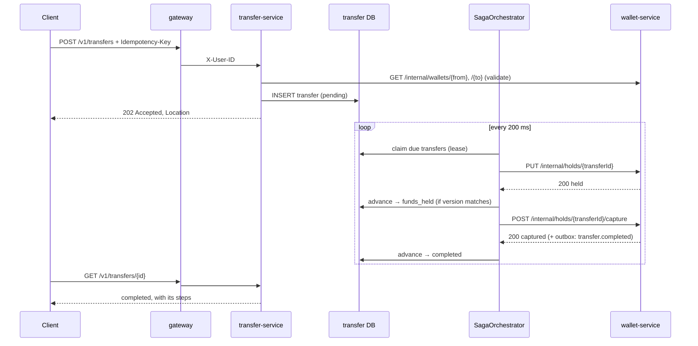

# Chapter 8 — The transfer service and sagas

> **Branch:** `ch08-transfer-saga` · **Builds on:** [Chapter 7](07-events-outbox.md) ·
> **Go reference:** `internal/transfer/{saga,state,store,transfer,http,wallet}.go`,
> `internal/wallet/holds.go`, `db/transfer/migrations/000001_transfers.up.sql`,
> `db/wallet/migrations/000005_holds.up.sql`

## What you'll learn

- Why a business operation that spans services can't use a database transaction
- The **saga** pattern: a sequence of local transactions with **compensations**
- **Orchestration vs choreography**
- Designing a saga as an explicit **state machine**, stored in the database
- **Holds**: reserving money so a saga's steps can be undone
- The most important distinction in distributed systems: **"no"** vs **"I don't know"**
- Idempotent steps, leases, optimistic locking and backoff: making a saga survive crashes
- Service-to-service calls with Spring's **HTTP interface clients** (`@HttpExchange`) and timeouts

## The problem

Chapter 3 moved money between two wallets in **one database transaction**: lock, check, debit,
credit, commit. It was atomic because both wallets lived in one database.

Now transfers get their own service. Why? Transfers will grow their own life — fraud screening,
manual review, limits, scheduled and recurring payments, cancellation — none of which belongs in
the ledger. The ledger should do one thing: keep the books. (The Go reference grows exactly this
way: episode 19 adds risk review to the transfer service without touching the wallet.)

But the transfer service has its own database (chapter 5's rule). Its transfer row and the
wallet's ledger entries can't share a transaction. And a distributed transaction (two-phase commit
across services) would couple them in time — one slow or dead participant blocks everyone, with
locks held — so in practice microservices don't use it.

## The concept: sagas

A **saga** is a business operation split into steps, each a **local transaction** in one service.
If a later step fails, earlier steps are undone by **compensating** steps — new transactions that
semantically reverse them. Not a rollback: history stays, and a reversal is added. (Exactly how our
append-only ledger already fixes mistakes.)

A transfer is three possible steps against the wallet:

| Step | Wallet does | Ledger entries | Compensated by |
|---|---|---|---|
| **hold** | Set money aside from the sender | debit sender, credit `holds` | release |
| **capture** | Pay the hold to the receiver | debit `holds`, credit receiver | — (the end) |
| **release** | Give the hold back | debit `holds`, credit sender | — (it *is* the compensation) |

Why a hold first, rather than "debit sender, then credit receiver"? Because between the two steps
the money must be **somewhere**. In a hold it can't be spent twice, it's visible in the books, and
it can go either way.

### The state machine

```mermaid
stateDiagram-v2
    [*] --> pending: POST /v1/transfers (202)
    pending --> funds_held: hold ✔
    pending --> failed: hold refused (e.g. insufficient_funds)
    funds_held --> completed: capture ✔
    funds_held --> compensating: capture refused
    compensating --> reversed: release ✔
    completed --> [*]
    failed --> [*]
    reversed --> [*]
    note right of compensating: release is retried until it works.\nThere is no "give up" edge:\nheld money must never be stranded.
```

The whole saga is a tiny table in code:

```java
public static Move moveFrom(State state) {
    return switch (state) {
        case PENDING      -> new Move(Step.HOLD,    State.FUNDS_HELD, State.FAILED);
        case FUNDS_HELD   -> new Move(Step.CAPTURE, State.COMPLETED,  State.COMPENSATING);
        case COMPENSATING -> new Move(Step.RELEASE, State.REVERSED,   null);  // never give up
        case COMPLETED, FAILED, REVERSED -> throw new IllegalStateException(state + " is final");
    };
}
```

And the state lives in the `transfers` table, so a saga survives any crash: whoever picks it up
next reads where it was.

### Orchestration vs choreography

| | Orchestration (what we build) | Choreography |
|---|---|---|
| Who drives | One orchestrator calls each step | Each service reacts to the previous one's event |
| Where the flow lives | In one place: `Saga.moveFrom` | Spread across services' event handlers |
| Easy to see "where is transfer X?" | Yes: one row | Hard: piece it together from events |
| Coupling | The orchestrator knows the participants | Participants know each other's events |
| Good for | Flows with branches and compensations | Simple, linear reactions (chapter 9's email) |

Money with compensations deserves the version you can read in one screen.

### "No" vs "I don't know"

This is the idea to take away from this chapter. When the orchestrator calls the wallet, three
things can happen:

```java
public sealed interface StepOutcome {
    record Succeeded() implements StepOutcome {}
    record Rejected(String reason) implements StepOutcome {}   // "no": 4xx
    record Failed(String detail) implements StepOutcome {}     // "I don't know": 5xx, timeout, connection reset
}
```

- **Rejected** — the wallet considered the request and said no (`insufficient_funds`). It will say
  no again. Take the saga's other branch.
- **Failed** — we **don't know** whether the step happened. A timeout after the wallet committed
  looks exactly like a timeout before. We must neither assume success nor assume failure; we **ask
  again**, with the same call, until we get a real answer.

Asking again is only safe because every wallet step is **idempotent**, keyed by the **hold id —
which is the transfer id**. Placing hold `X` twice holds the money once; capturing it twice pays
once. That's chapter 4's idea again, now between services.

```java
static boolean isRejection(HttpStatusCode status) {
    return status.is4xxClientError() && status.value() != 408 && status.value() != 429;
}
```

### Surviving crashes and concurrency

Any number of orchestrator instances may run, and any may die mid-step.

- **Claims with leases.** An orchestrator claims due transfers with
  `UPDATE ... WHERE id IN (SELECT ... FOR UPDATE SKIP LOCKED) RETURNING *`, pushing their
  `next_attempt_at` to the end of a 10 s **lease**. If it dies, the lease expires and another
  instance claims them and re-runs the step (safe: idempotent).
- **Optimistic locking.** Every write bumps `version`; `advance` only succeeds
  `WHERE state = :state AND version = :version`. A slow instance that wakes up after its lease
  can't overwrite newer progress — its update matches zero rows.
- **Backoff with jitter.** A failed step is retried after 1 s, 2 s, 4 s … capped at a minute, each
  randomised, so a recovering wallet isn't hit by every saga at once.
- **History.** Every try is a row in `transfer_steps`; `GET /v1/transfers/{id}` shows them.

## Architecture after this chapter



## Step by step

### The wallet: holds and an internal API

1. [`V5__holds.sql`](../wallet-service/src/main/resources/db/migration/V5__holds.sql) — a `holds`
   table (id chosen by the caller, status `held | captured | released`, both transaction ids) and a
   `holds` system account per currency.
2. [`holds/HoldService`](../wallet-service/src/main/java/dev/payments/wallet/holds/HoldService.java) —
   `place` locks the wallet and checks the balance (chapter 3's rule, unchanged), and replays an
   existing hold with the same terms; `capture` and `release` lock the hold and replay a settlement
   done the same way, refuse one done the other way (`hold_settled`). A capture enqueues the
   `transfer.completed` event: the moment the receiver has the money.
3. [`holds/InternalController`](../wallet-service/src/main/java/dev/payments/wallet/holds/InternalController.java) —
   `GET /internal/wallets/{id}`, `PUT /internal/holds/{id}`, `POST .../capture`, `POST .../release`.
   The gateway has no route to `/internal/**`, so no client can reach them (a `GatewayIT` test
   checks).
4. **Retired:** the wallet's own `POST /v1/transfers`, `WalletService.transfer` and
   `TransferController`. Its locking survives in `place`; its concurrency test survives as
   `HoldServiceIT.concurrentHoldsNeverOverdraw`. Code that a new design replaces should go.

### The transfer service

5. **Module and database** — `transfer-service/` (port 8083) with its own `transfer` database and
   [`V1__transfers.sql`](../transfer-service/src/main/resources/db/migration/V1__transfers.sql):
   the saga's state, `attempts`, `next_attempt_at`, `version`, and `UNIQUE (user_id, idempotency_key)`.
   The transfer row is its own idempotency record — no separate table needed.
6. **The wallet client** — an interface, implemented by Spring:

   ```java
   @HttpExchange("/internal")
   public interface WalletClient {
       @GetExchange("/wallets/{id}")          WalletInfo wallet(@PathVariable UUID id);
       @PutExchange("/holds/{id}")            HoldInfo placeHold(@PathVariable UUID id, @RequestBody PlaceHold body);
       @PostExchange("/holds/{id}/capture")   HoldInfo capture(@PathVariable UUID id, @RequestBody Capture body);
       @PostExchange("/holds/{id}/release")   HoldInfo release(@PathVariable UUID id);
   }

   @ImportHttpServices(group = "wallet", types = WalletClient.class)
   class WalletClientConfig {}
   ```

   ```yaml
   spring.http.serviceclient.wallet:
     base-url: http://localhost:8081
     connect-timeout: 1s
     read-timeout: 3s      # always set timeouts: the default waits forever
   ```

7. **The saga** — `saga/State` (transitions), `saga/Saga` (the move table), `saga/StepOutcome`.
8. **`wallet/WalletSteps`** — runs a step and turns HTTP results into outcomes: 4xx (except
   408/429) → `Rejected(code)`, everything else → `Failed`.
9. **`saga/TransferRepository`** — `create` (`ON CONFLICT DO NOTHING`), `claim`, `advance`,
   `retryLater`, `steps`.
10. **`saga/SagaOrchestrator`** — `@Scheduled` every 200 ms: claim, run one step each, record the outcome.
11. **`saga/TransferService` + `TransferController`** — `POST /v1/transfers` validates against the
    wallet (sender's own wallet, receiver exists, same currency), stores `pending`, returns
    **202 Accepted** with a `Location`. Same key + same body ⇒ the same transfer
    (`Idempotent-Replayed: true`); same key + different body ⇒ 422. `GET /v1/transfers/{id}`
    returns the state, `failure_reason` and every step.
12. **The gateway** routes `/v1/transfers` to the transfer service instead of the wallet. Clients
    see the same URL.

> **Why validate synchronously at creation?** We could accept anything and let the hold fail later.
> But "your wallet doesn't exist" is a better answer at request time than a `failed` transfer a
> second later, and it costs one call. The trade-off: if the wallet is down, creating transfers
> returns **503**. Chapter 10 adds a circuit breaker so that failure is fast and contained.

## Run it

```bash
docker compose down -v && docker compose up -d --wait     # new database: transfer
./mvnw -q install -DskipTests
java -jar auth-service/target/auth-service-1.0.0-SNAPSHOT.jar --auth.private-key-location=file:secrets/auth-signing-key.pem &
java -jar wallet-service/target/wallet-service-1.0.0-SNAPSHOT.jar &
java -jar transfer-service/target/transfer-service-1.0.0-SNAPSHOT.jar &
java -jar gateway/target/gateway-1.0.0-SNAPSHOT.jar &
```

Register two users, open a USD wallet for each, deposit into the first, then transfer
([`api/gateway.http`](../api/gateway.http)). We ran exactly this while writing the chapter:

```json
{"state": "completed", "steps": [
  {"step": "hold",    "outcome": "succeeded"},
  {"step": "capture", "outcome": "succeeded"}]}
```

Alice went from 1,000 to 700, Bob to 300; a second transfer of 5,000 ended `failed` with
`insufficient_funds`; and `wallet.transfer.completed.v1` appeared on Kafka.

Stop the wallet service and send another transfer: you get `503`, because creating a transfer checks
the wallets synchronously (chapter 10 makes that failure fast). What happens when the wallet fails
*during* a saga is what `TransferSagaIT` scripts: the step is retried with backoff until it gets an
answer.

## Test it

| Test | What it proves |
|---|---|
| `SagaTest` | Every move is an allowed transition; final states have no moves; held money can never just "fail" |
| `WalletStepsTest` | Which HTTP statuses are a "no" and which are "I don't know" |
| `TransferSagaIT` | Happy path (hold, capture: the hold id **is** the transfer id); refused hold ⇒ `failed`, nothing else called; refused capture ⇒ `compensating` ⇒ release fails twice, retried ⇒ `reversed`; 5xx steps retried until they succeed; same key ⇒ same transfer, different body ⇒ 422; validation of wallets before accepting; only the sender sees a transfer |
| `HoldServiceIT` (wallet) | Place/capture/release move the right money; every step is idempotent; different terms ⇒ conflict; no double settlement; insufficient funds, wrong owner, currency mismatch refused; 30 concurrent holds never overdraw |
| `InternalApiIT` (wallet) | The internal JSON contract the transfer service depends on |
| `GatewayIT` (new cases) | `/v1/transfers` goes to the transfer service; `/internal/**` is unreachable |

`TransferSagaIT` uses `FakeWallet`, a scripted wallet on the JDK's HTTP server:
`wallet.script("release", alice.id(), "503", "503")` makes Alice's next two releases fail. Scripts
are keyed by wallet, and every test uses fresh wallets, so background retries from one test can't
consume another test's script.

## How this connects

The hold is chapter 3's lock-and-check, chapter 4's idempotency key is now the hold id, chapter 6's
gateway hid the move of `/v1/transfers` from clients, and chapter 7's outbox announces the capture.
Chapter 9 listens for that announcement to email the receiver. Chapter 10 makes the
transfer → wallet call resilient, and chapter 11 lets you follow one transfer across all of it.

## Key takeaways

- Across services, replace distributed transactions with **sagas**: local transactions plus compensations.
- Design the saga as an explicit **state machine**, stored durably; make illegal transitions impossible.
- Reserve before you commit: **holds** make steps reversible and keep money visible in between.
- Distinguish **"no"** (take the other branch) from **"I don't know"** (retry the same idempotent call).
- Compensations must not give up; alert a human instead.
- Leases + optimistic locking let many orchestrators run and any of them crash.
- Use `@HttpExchange` interfaces for service clients, and **always set timeouts**.
- Delete what the new design replaces.

## Exercises

1. Add a `transfer` outbox in the transfer service and publish `transfer.failed.v1` and
   `transfer.reversed.v1`, so the sender can be told (chapter 9 would consume them).
2. Add cancellation: `POST /v1/transfers/{id}/cancel` is allowed in `pending` and `funds_held`.
   Which states and transitions do you add?
3. Make the orchestrator run each claimed transfer's step in parallel with virtual threads
   (`Executors.newVirtualThreadPerTaskExecutor()`). What must stay sequential?
4. Kill the transfer service between `hold` and `capture` (add a breakpoint, then stop it). Start it
   again. What happens, and which property decides how long it takes?

**Next:** [Chapter 9 — The notification service](09-notification-service.md)
