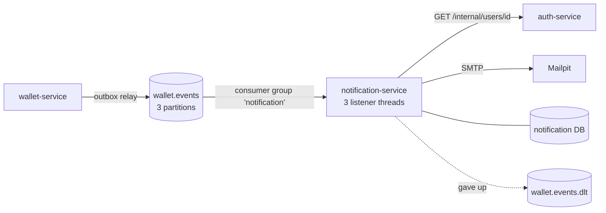

# Chapter 9 — The notification service

> **Branch:** `ch09-notification-service` · **Builds on:** [Chapter 8](08-transfer-saga.md) ·
> **Go reference:** `internal/notification/{consume,notifier,store,users,message}.go`,
> `db/notification/migrations/000001_notifications.up.sql`

## What you'll learn

- How to build a service that only **consumes** events, which its producers don't even know exists
- **Consumer groups**, offsets and partitions in practice
- **Idempotent consumers**: surviving at-least-once delivery
- Retries with backoff for transient failures, and a **dead-letter topic** for poison messages
- Transient vs permanent errors, again, now on the consuming side
- The **tolerant reader** pattern for event contracts
- A real Kafka gotcha: `auto.offset.reset=latest` silently losing events

## The problem

When money arrives, people expect an email. Chapter 7 gave us the events; now something has to
react to them. It must:

- send **each** email once, even though the outbox delivers each event **at least** once;
- keep going when the auth service or the mail server has a bad minute;
- not let one broken message block every email behind it;
- never require the wallet to change.

## The concepts

### A consumer, not a callee



Nobody calls the notification service. It joins the consumer group `notification`; Kafka assigns
it the topic's partitions and remembers, per group, how far it has read (the **committed offset**).
Restart it and it carries on where it stopped. Run three instances and they split the three
partitions. The wallet doesn't change at all: that's the payoff of chapter 7.

### Idempotent consumers

The outbox delivers at least once, so the same event can arrive twice. The consumer makes
duplicates harmless with a table whose **primary key is the event id and the person**:

```java
@Transactional
public boolean deliver(Notification n) {
    String email = emailOf(n);
    int inserted = jdbc.sql("""
            INSERT INTO notifications (event_id, user_id, recipient, subject)
            VALUES (:event, :user, :recipient, :subject)
            ON CONFLICT (event_id, user_id) DO NOTHING
            """) ... .update();
    if (inserted == 0) {
        return false;          // this event already notified this person: skip
    }
    mail.send(message);        // throws if SMTP is down: the row rolls back, the retry sends it
    return true;
}
```

Two deliveries racing each other? The second `INSERT` waits on the first's row lock, then inserts
nothing. Email and database are two systems again, so there is still a choice to make:

| Order | Crash in the middle |
|---|---|
| record, commit, send | email **lost** |
| record, send, commit (ours) | email sent **twice** on redelivery |

A rare duplicate beats a missing payment notification. Know which way your design fails.

### Transient vs permanent failures

Chapter 8's "no" vs "I don't know" has a twin on the consuming side:

| Failure | Example | What we do |
|---|---|---|
| Transient | auth answers 503, SMTP refuses a connection | retry in place: 500 ms, 1 s, 2 s, 4 s |
| Permanent | JSON that doesn't parse; a user auth says doesn't exist (404) | skip retries |
| Either, after the last retry | | publish to `wallet.events.dlt` and move on |

```java
@Bean
DefaultErrorHandler errorHandler(KafkaTemplate<?, ?> kafka, NotificationProperties properties) {
    var recoverer = new DeadLetterPublishingRecoverer(kafka,
            (record, ex) -> new TopicPartition(properties.deadLetterTopic(), record.partition()));
    var backOff = new ExponentialBackOffWithMaxRetries(properties.retry().attempts());
    backOff.setInitialInterval(properties.retry().initialDelay().toMillis());
    backOff.setMultiplier(properties.retry().multiplier());
    var handler = new DefaultErrorHandler(recoverer, backOff);
    handler.addNotRetryableExceptions(PermanentException.class);
    return handler;
}
```

Why a **dead-letter topic**? Kafka delivers a partition in order. A message that fails forever
would block every message behind it in its partition: one malformed event and nobody gets emails
again. Parking it on the DLT (with headers saying which topic, partition, offset and exception)
lets the partition move on, and keeps the message for a human to inspect and replay.

> **Go reference difference:** the Go notifier writes dead letters to a database table with a replay
> endpoint. A DLT topic is the Kafka-native equivalent; Spring Kafka ships the recoverer for it.

### The tolerant reader

```java
public record WalletEvent(UUID id, String type, Data data) {
    public record Wallet(UUID id, UUID ownerId, String currency) {}
    public record Data(@Nullable Wallet wallet, @Nullable Wallet from, @Nullable Wallet to, long amount) {}
}
```

The notifier declares only the fields it reads, and Jackson ignores the rest. The wallet can add
fields without breaking it (a test publishes an event with an extra `some_field_added_later`).
Unknown event types produce no notification instead of an error. There is no shared events
library: the contract is the JSON, documented in [architecture.md](architecture.md).

### Events carry ids, not addresses

The event says *which user* (`owner_id`), not their email. Email addresses change, and events stay
in Kafka for days. So the notifier asks the service that owns users: auth gains
`GET /internal/users/{id}`, reachable only inside the network, like the wallet's `/internal` API.

### A gotcha we hit while writing this chapter

The first end-to-end run sent **no emails at all**, with no errors anywhere. The consumer was
configured with `auto-offset-reset: latest` (a new group starts at the newest event, so you don't
email people about last week). But the services started together, and the notifier's first
partition assignment arrived **four seconds** after the transfer's events were published:

```
23:02:48.231  transfer-service      capture succeeded             (event published)
23:02:52.540  notification-service  partitions assigned: [...]    (starts at "latest": after it)
```

`latest` meant "after the events we cared about". We switched to `earliest`: a new group reads the
retained history, and the idempotency table makes re-reading harmless. If you deploy a consumer
for the first time onto a topic with months of history, set its starting offsets once on purpose
(`kafka-consumer-groups.sh --reset-offsets --to-datetime ...`) rather than relying on `latest`.

## Step by step

1. **auth-service** — `InternalUserController`: `GET /internal/users/{id}` → `{id, email}`.
2. **notification-service** (port 8084, database `notification`) — dependencies: `spring-boot-starter-kafka`,
   `-mail`, `-restclient`, `-jdbc`, Flyway, PostgreSQL.
3. **Migration** — [`V1__notifications.sql`](../notification-service/src/main/resources/db/migration/V1__notifications.sql):
   `PRIMARY KEY (event_id, user_id)`.
4. **`WalletEvent`** — the tolerant reader; **`Notifications`** — the pure decision of who gets
   what (deposit: the owner; transfer: receiver *and* sender), with amounts formatted using each
   currency's own decimals (`1050 USD` → `10.50 USD`, `500 JPY` → `500 JPY`).
5. **`AuthClient`** — an `@HttpExchange` interface in HTTP service group `auth`, like chapter 8's
   wallet client, with timeouts.
6. **`Notifier`** — record, send, commit; a 404 from auth is a `PermanentException`.
7. **`WalletEventListener`** — `@KafkaListener(topics = "${notification.topic}")`. Returning
   normally commits the offset; throwing hands the record to the error handler.
8. **`KafkaConfig`** — the `DefaultErrorHandler` above (Spring Boot plugs the bean into the
   listener container factory automatically) and the DLT as a `NewTopic` with matching partitions.
9. **Configuration** — group id `notification`, `concurrency: 3` (one thread per partition),
   `auto-offset-reset: earliest`, Mailpit on `localhost:1025`.
10. **Compose** — Mailpit (`axllent/mailpit`), SMTP on 1025, web UI on 8025.

## Run it

```bash
docker compose down -v && docker compose up -d --wait     # new database, and Mailpit
./mvnw -q install -DskipTests
# auth, wallet, transfer and gateway as in chapter 8, plus:
java -jar notification-service/target/notification-service-1.0.0-SNAPSHOT.jar &
```

Register two users, deposit, transfer ([`api/gateway.http`](../api/gateway.http)), then open
**http://localhost:8025**. Our run while writing this chapter:

```
alice@example.com | Deposit received: 10.50 USD
bob@example.com   | You received 3.00 USD
alice@example.com | You sent 3.00 USD
```

Look at a dead letter: stop the auth service, deposit, wait ~8 seconds (four retries), then

```bash
docker exec payments-kafka /opt/kafka/bin/kafka-console-consumer.sh --bootstrap-server localhost:9092 \
  --topic wallet.events.dlt --from-beginning --formatter-property print.headers=true
```

## Test it

| Test | What it proves |
|---|---|
| `NotificationsTest` | Who is told what for each event type; other types need no email; per-currency decimal formatting |
| `NotificationFlowIT` | With real PostgreSQL, Kafka and Mailpit (read through its HTTP API) and a scripted fake auth: a deposit emails the owner (and an unknown extra field is ignored); **the same event twice sends one email**; a transfer emails both sides; two 503s from auth are retried away; an unknown user and a malformed message both land on `wallet.events.dlt` |
| `AuthApiIT` (new case) | `/internal/users/{id}` returns the email, 404 for unknown users |

Mailpit runs as a plain Testcontainers `GenericContainer`; its SMTP port goes into `spring.mail.*`
with `@DynamicPropertySource`. Each test uses fresh users with unique addresses, so tests can share
one inbox without clearing it.

## How this connects

This chapter closes the loop chapter 7 opened: the outbox promised *at least once*, and the
idempotent consumer turns that into *effectively once*. The five services now form the complete
system. Chapter 10 makes their synchronous calls (transfer → wallet, notification → auth) resilient;
chapter 11 makes the whole flow visible as one trace, from the HTTP request to the email.

## Key takeaways

- Consumers are how you add behaviour without touching producers.
- At-least-once delivery + an idempotency key per effect = effectively once.
- Decide which way each two-system step fails (lost vs duplicated), and choose on purpose.
- Retry transient errors with backoff; send permanent ones, and exhausted ones, to a dead-letter topic.
- One poison message must never block a partition.
- Read only what you need from events, and ignore the rest.
- Events carry ids; look up mutable data (emails) from its owner when you need it.
- Mind `auto.offset.reset`: `latest` can skip events silently on a group's first start.

## Exercises

1. Add a small "replay" tool: read `wallet.events.dlt` and republish chosen messages to `wallet.events`.
2. Make SMTP outages *not* use up the four retries: classify mail exceptions separately and back off longer.
3. Add `notification_dead_letters_total` as a Micrometer counter (chapter 11 will scrape it).
4. Run two notification instances and watch the partitions being split between them in the logs.

**Next:** Chapter 10 — Resilience
