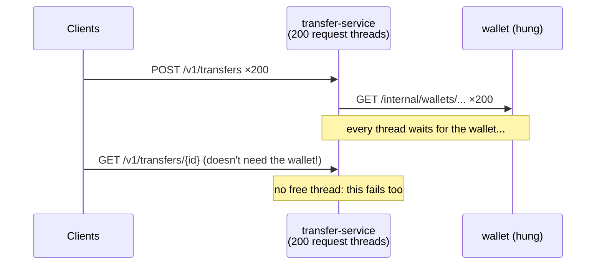
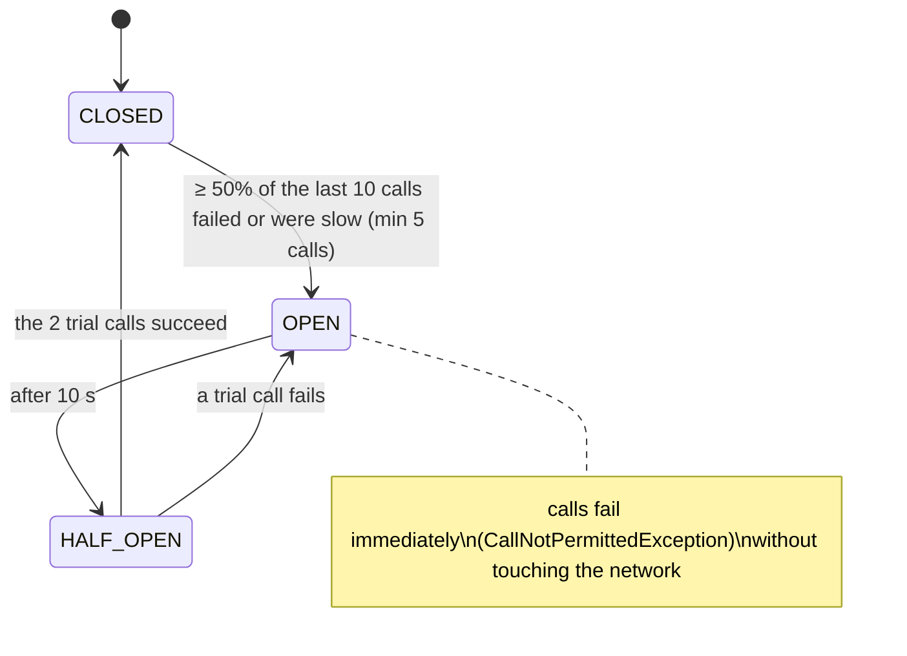
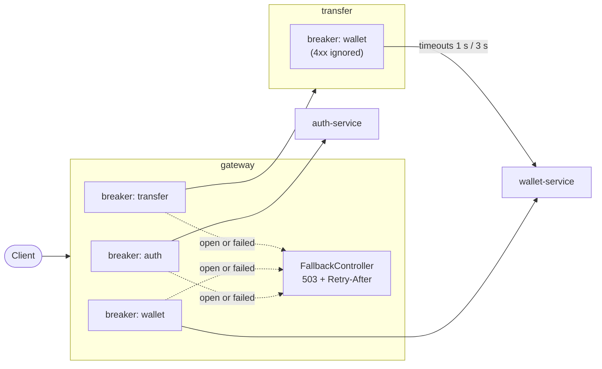

# Chapter 10 — Resilience

> **Branch:** `ch10-resilience` · **Builds on:** [Chapter 9](09-notification-service.md) ·
> **Go original:** the deadlines in `internal/wallet/walletclient/client.go`, the gateway's timeouts in
> `internal/gateway/proxy.go`, and the bulkhead in episode 22

## What you'll learn

- How one slow service takes down the services that call it: **cascading failure**
- **Timeouts**: the first and most important resilience tool
- **Circuit breakers**: closed, open, half-open, and what counts as a failure
- Why you **retry in one layer only**
- Resilience4j with Spring Boot (`resilience4j-spring-boot4`) in a service
- Spring Cloud Gateway's `CircuitBreaker` filter, fallbacks, and the default time limiter trap
- How to *show* that resilience works, with numbers

## The problem

By now the system has synchronous calls between services:

- gateway → every service
- transfer-service → wallet (wallet lookups at creation, holds in the saga)
- notification-service → auth (email lookups)

A dead service is the easy case: connections are refused in milliseconds. The hard case is a
service that is **slow or hung** — garbage collection, a locked table, a saturated pool. Every call
to it waits. Waiting calls hold threads. Request threads run out, and the caller stops answering
*anything*, including requests that never touch the slow service. The failure has cascaded.



## The concepts

### 1. Timeouts, everywhere

A call without a timeout can wait forever. We have set one on every outbound call since the client
was written:

| Caller → callee | Connect | Response |
|---|---|---|
| gateway → services | 1 s | 5 s |
| transfer-service → wallet | 1 s | 3 s |
| notification-service → auth | 1 s | 3 s |

A timeout bounds how long *one* call can hurt. It doesn't stop a caller from sending the next
thousand calls into the same hole, each waiting its full 3 seconds.

### 2. Circuit breakers

A circuit breaker watches the outcomes of calls to one dependency and, when too many fail, stops
calling it for a while:



While **open**, callers get an immediate error: no thread waits, the struggling service gets room
to recover, and the user hears "try later" in milliseconds instead of seconds. **Half-open** lets a
few trial calls through to find out whether it's back.

This is what we measured with the wallet process frozen (`kill -STOP`), creating transfers:

```
503 3.050s   ┐
503 3.016s   │ breaker closed: each call waits the full 3 s read timeout
503 3.021s   │
503 3.022s   │
503 3.025s   ┘ 5 failures out of 5: the breaker opens
503 0.015s   ┐
503 0.009s   │ open: fails at once, the wallet isn't even called
503 0.007s   ┘
```

### 3. What counts as a failure?

This is where breakers are most often misconfigured. A `422 insufficient_funds` from the wallet is
the wallet **working perfectly**. If 4xx responses counted as failures, a burst of users with empty
wallets would open the breaker and block everyone. So:

```yaml
ignore-exceptions:
  - org.springframework.web.client.HttpClientErrorException   # 4xx: a healthy "no"
```

Failures are 5xx, timeouts, connection errors, and calls slower than 2 s (`slow-call-duration-threshold`).
It's chapter 8's "no" vs "I don't know" once more. A test checks that 20 lookups of unknown wallets
leave the breaker closed.

### 4. Retry in one layer only

Each layer that retries multiplies the load on a struggling service: if the client retries 3×, the
gateway 3× and the service 3×, one user click becomes 27 calls into the fire. Our rules:

| Where | Retries? | Why |
|---|---|---|
| Client → gateway | The client, with its `Idempotency-Key` | It knows whether the user is still waiting |
| Gateway → service | **No** | It can't know if a `POST` is safe to repeat |
| Transfer creation → wallet | **No** | The client retries the whole request |
| Saga steps → wallet | Yes, with exponential backoff + jitter | Background work; steps are idempotent |
| Kafka consumer → auth | Yes, 4× with backoff, then DLT | Background work; deduplicated |

And while the breaker is open, a saga step returns `Failed("circuit open")` without a network call,
so retrying sagas don't hammer the wallet either.

### 5. Breakers at the edge

The gateway gets a breaker per route (`auth`, `wallet`, `transfer`). When a service can't be
reached or times out, the request is forwarded to a **fallback** that answers in our usual shape:

```json
HTTP/1.1 503 Service Unavailable
Retry-After: 10
Content-Type: application/problem+json

{"status": 503, "code": "unavailable", "detail": "the service is not available, try again later", "request_id": "..."}
```

Each route has its **own** breaker: the wallet being down doesn't stop transfers' status pages or
logins (a test checks).

### The trap: Spring Cloud's default 1-second time limiter

Spring Cloud CircuitBreaker wraps every breaker in a **time limiter of 1 second by default**. Any
request slower than that — a big statement, a cold cache — gets cut off and becomes a fallback 503,
even though the service was about to answer. We proved it: a test downstream that answers in 1.5 s
returns **503** with the default, and **200** once we disable the time limiter and let the gateway's
own `response-timeout: 5s` be the only timeout:

```yaml
spring.cloud.circuitbreaker.resilience4j.disable-time-limiter: true
```

Two timeouts on the same call is one too many; know which one you're using.

## Architecture after this chapter



## Step by step

### transfer-service

1. Dependency `io.github.resilience4j:resilience4j-spring-boot4` (version from the Spring Cloud BOM).
2. Breaker `wallet` configured in [`application.yml`](../transfer-service/src/main/resources/application.yml)
   under `resilience4j.circuitbreaker.instances.wallet`: count-based window of 10, at least 5 calls,
   50 % failure or slow-call rate, 10 s open, 2 half-open trials, 4xx ignored.
3. `WalletSteps` and `TransferService` get the breaker from the `CircuitBreakerRegistry` and run
   every wallet call through it:

   ```java
   this.breaker = breakers.circuitBreaker("wallet");
   ...
   breaker.executeRunnable(() -> wallet.placeHold(...));
   } catch (CallNotPermittedException e) {
       return new StepOutcome.Failed("wallet circuit breaker is open");   // retry later
   }
   ```

   At creation, an open breaker becomes `UnavailableException` → `503` immediately.
4. Health: `/actuator/health` shows the breaker's state with `register-health-indicator: true`, and
   `allow-health-indicator-to-fail: false` keeps an open breaker from marking the transfer service
   itself unhealthy. If it did, Kubernetes would restart a perfectly good transfer service because
   the wallet was down.

> **Why call the breaker explicitly instead of `@CircuitBreaker` on a method?** The annotation works
> through an AOP proxy and hides which calls are protected. Here, the protected call is visible in the
> line that makes it, and exceptions are translated right next to it.

### gateway

5. Dependency `spring-cloud-starter-circuitbreaker-reactor-resilience4j`.
6. A `CircuitBreaker` filter on each route with `fallbackUri: forward:/fallback/unavailable`, and a
   `default` breaker config (window 20, minimum 10 calls, 50 %, 10 s open).
7. `FallbackController` returns the 503 Problem Details with `Retry-After: 10`; the path is public
   in `SecurityConfig` so the forward always works.
8. `disable-time-limiter: true`, as explained above.

## Run it

```bash
docker compose up -d --wait
# start auth, wallet, transfer and gateway as in chapter 8
```

Then stop the wallet and watch:

```bash
kill -STOP $(pgrep -f wallet-service)     # freeze it: connections hang instead of failing
```

Send a few transfers through the gateway and time them (`curl -w '%{time_total}'`): five slow ones,
then instant 503s. Check the breaker:

```bash
curl -s localhost:8083/actuator/health | jq '.components.circuitBreakers'
```

```bash
kill -CONT $(pgrep -f wallet-service)     # thaw it: after 10 s, trial calls close the breaker
```

## Test it

| Test | What it proves |
|---|---|
| `WalletStepsBreakerTest` | An open breaker fails a saga step as `Failed` (retry later), never `Rejected`, without calling the wallet |
| `WalletBreakerIT` | Repeated 503s open the breaker; while open, requests get 503 in < 500 ms and the wallet sees **no** calls; once the wallet recovers, trial calls close it again; 20 refusals (404) leave it closed; health shows `OPEN` while the service stays `UP` |
| `GatewayResilienceIT` | An unreachable wallet gets a 503 Problem Details with `Retry-After`; the breaker opens and later requests fail in < 500 ms; the transfer route's breaker stays closed |
| `GatewayIT` (new case) | A healthy 1.5 s response is **not** cut off (it was, with the default time limiter) |

`TransferSagaIT` scripts many wallet failures on purpose, so it configures a very large breaker
window: it tests the saga, and `WalletBreakerIT` tests the breaker. Shared state between tests is
the enemy; make it explicit.

## How this connects

Chapter 8 taught "no" vs "I don't know" for a single call. This chapter applies it to the
*pattern* of calls: many "I don't know"s in a row means stop asking for a while. Chapter 11 makes
breaker states, retry counts and latencies visible as metrics and traces, so you can see a
dependency struggling before users do.

## Key takeaways

- Every outbound call needs a timeout. Choose it from what the caller can afford to wait.
- Circuit breakers stop a slow dependency from consuming your threads, and give it room to recover.
- Count only real failures: a 4xx is a healthy answer.
- Retry in one layer; never blindly retry non-idempotent requests at the gateway.
- One breaker per dependency (per route at the gateway), so failures stay contained.
- An open breaker to a dependency shouldn't make *you* look unhealthy.
- Know every timeout on a path; Spring Cloud's default 1 s time limiter is easy to miss.

## Exercises

1. Add a **bulkhead** to transfer creation: Spring Framework 7's `@ConcurrencyLimit(10)` (with
   `@EnableResilientMethods`) on the wallet lookup, so at most 10 request threads can wait on the
   wallet at once. Test it with 50 concurrent requests against a frozen wallet.
2. The notification consumer has no breaker. What would go wrong if it had one with the current
   retry settings? (Hint: how quickly would messages exhaust their four retries and pile onto the DLT?)
   Design a better reaction: pause the listener container while auth is down.
3. Put [Toxiproxy](https://github.com/Shopify/toxiproxy) between transfer-service and the wallet
   (the Go original does in `deploy/chaos`) and add 2 s of latency. Which breaker setting reacts?

**Next:** [Chapter 11 — Observability](11-observability.md)
