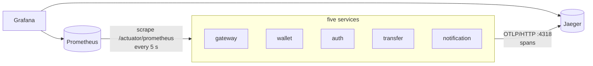

# Chapter 11 — Observability

> **Branch:** `ch11-observability` · **Builds on:** [Chapter 10](10-resilience.md) ·
> **Go reference:** `internal/platform/telemetry`, `internal/platform/outbox/relay.go` (trace carry),
> `db/*/migrations/*_trace_context.up.sql`, `deploy/{prometheus,grafana}`

## What you'll learn

- The three signals — **traces, metrics, logs** — and what question each answers
- Distributed tracing with **Micrometer Tracing on OpenTelemetry**, exported over OTLP to Jaeger
- How trace context travels: HTTP headers, Kafka headers, and — the part frameworks can't do for
  you — **through a database table**, for the outbox and the saga
- Metrics with Micrometer and Prometheus: what to measure, and **custom business metrics**
- Correlating logs with traces
- Running Jaeger, Prometheus and Grafana locally, with a provisioned dashboard
- Two real surprises we hit, and how we found them

## The problem

A user says: "my transfer took ages and the email never came". One click touched five services,
three databases, Kafka, two background loops and an SMTP server. Each service's logs show a slice.
Which slice is slow? Which one failed? Without help, you're grepping five log streams by timestamp.

| Question | Signal |
|---|---|
| What happened to *this* request, step by step, across services? | **Trace** |
| Is the system healthy *overall*? Is it getting worse? | **Metrics** |
| What exactly did this service say at that moment? | **Logs**, found via the trace id |

## The concepts

### Traces and spans

A **trace** is the whole journey of one request; a **span** is one timed piece of work inside it
(an HTTP call, a DB query, a Kafka send), with a parent. Services pass the trace along in the
W3C **`traceparent`** header:

```
traceparent: 00-cad35a50d5f61dbd9d010755a8ee115c-dff27f5794201332-01
                 └──────── trace id ────────────┘ └ parent span ┘ └ sampled
```

Spring Boot does almost everything with **Micrometer Observation**: incoming HTTP requests,
`RestClient` calls (including our `@HttpExchange` clients), the gateway's proxying, Spring Security's
filters, Redis, and — with `observation-enabled: true` — Kafka sends and listener invocations. Each
becomes a span, and the context is propagated in headers automatically.

### The gap: "write it down, do it later"

Tracing follows a request across threads and network calls. It **cannot** follow it through a
database row that another thread picks up seconds later. We have two such places:

- the **outbox**: the HTTP request writes the event; the relay publishes it later;
- the **saga**: the HTTP request writes the transfer; the orchestrator runs its steps later.

Without help, each would start a fresh trace, and the transfer would appear as several unrelated
traces. So we do what the Go reference does: **store the `traceparent` with the row**, and when the
background loop picks the row up, **start a span whose parent is the stored context**.

```java
// when writing the row (inside the request's trace)
.param("traceparent", traces.current())

// when the background thread picks it up
Span span = traces.continueTrace(message.traceparent(), "outbox publish", Span.Kind.PRODUCER);
try (var scope = tracer.withSpan(span)) {
    kafka.send(record).get(10, SECONDS);   // KafkaTemplate's span, and the record's header, become children
} finally {
    span.end();
}
```

`TraceContexts` (one small class per service that needs it) wraps Micrometer's `Tracer` and
`Propagator` for exactly this.

### The result: one transfer, one trace

This is the trace of one transfer from our run while writing the chapter, as Jaeger returned it —
**33 spans, five services**:

```
gateway                http post                              ← the client's request
gateway                secured request, evalsha (rate limit)
transfer-service       http post /v1/transfers
wallet-service         http get /internal/wallets/{id}        ← validation, twice
transfer-service       saga hold                              ← later, on the orchestrator's thread
wallet-service         http put /internal/holds/{id}
transfer-service       saga capture
wallet-service         http post /internal/holds/{id}/capture
wallet-service         outbox publish                         ← later, on the relay's thread
wallet-service         wallet.events send
notification-service   wallet.events process                  ← in another process, via Kafka
auth-service           http get /internal/users/{id}          ← the receiver's email
auth-service           http get /internal/users/{id}          ← the sender's email
```

Every hop that crosses a thread, a process, a database row or a broker is in the same trace. When a
transfer is slow, you open it and see where the time went.

### Metrics: what to measure

Traces explain one request; metrics tell you whether there's a problem at all. Spring Boot gives you
the **RED** metrics for free: **R**ate, **E**rrors and **D**uration of every HTTP request
(`http_server_requests_seconds`), plus JVM, connection pool, Kafka client and Resilience4j metrics.
We add percentile histograms so Prometheus can compute p95 latency, and an `application` tag on
everything.

And we add a few **business metrics**, the ones that say whether money is moving:

| Metric | Type | Where | Why it matters |
|---|---|---|---|
| `outbox_unpublished` | gauge | wallet | Events waiting for Kafka. Should hover near 0; a rising line means Kafka is down or the relay is stuck |
| `transfers_finished_total{state}` | counter | transfer | Completed vs failed vs reversed: the business pulse |
| `saga_step_retries_total{step}` | counter | transfer | The wallet is struggling before anything fails outright |
| `notifications_sent_total` | counter | notification | Emails are flowing |
| `notification_dead_letters_total` | counter | notification | Should stay at 0. When it moves, someone looks at the DLT |
| `resilience4j_circuitbreaker_state` | gauge | transfer, gateway | Which dependency is cut off right now |

### Logs that point to traces

Every log line now carries the trace id, span id and request id:

```
INFO [cad35a50d5f61dbd9d010755a8ee115c,dff27f5794201332,] ... transfer 88c8...: capture succeeded, now COMPLETED
```

```yaml
logging.pattern.correlation: "[%X{traceId:-},%X{spanId:-},%X{requestId:-}] "
```

Find the trace in Jaeger, copy its id, grep the logs of any service for it. The request id from
chapter 1 stays: it's the short id a client quotes from an error response.

## Architecture after this chapter



## Step by step

1. **Dependencies** (every service): `spring-boot-starter-opentelemetry` (Micrometer Tracing,
   the OpenTelemetry bridge and the OTLP exporter) and `micrometer-registry-prometheus`.
2. **Configuration** (every service):

   ```yaml
   management:
     tracing:
       sampling.probability: 1.0      # every trace on a laptop; production samples (e.g. 0.1)
       propagation.type: w3c
     opentelemetry.tracing.export.otlp.endpoint: http://localhost:4318/v1/traces
     otlp.metrics.export.enabled: false   # metrics are pulled by Prometheus
     metrics:
       tags.application: ${spring.application.name}
       distribution.percentiles-histogram.http.server.requests: true
     endpoints.web.exposure.include: health,info,prometheus
   ```

3. **Kafka** — `spring.kafka.template.observation-enabled: true` (wallet) and
   `spring.kafka.listener.observation-enabled: true` (notification).
4. **Outbox trace context** — [`V6__outbox_trace_context.sql`](../wallet-service/src/main/resources/db/migration/V6__outbox_trace_context.sql)
   adds `traceparent`; `Outbox.enqueue` stores `traces.current()`; `OutboxRelay` continues it.
5. **Saga trace context** — [`V2__trace_context.sql`](../transfer-service/src/main/resources/db/migration/V2__trace_context.sql)
   on `transfers`; `TransferService.create` stores it; `SagaOrchestrator.step` runs each step in a
   `saga <step>` span continuing it.
6. **Business metrics** — the gauge in `OutboxRelay`, counters in `SagaOrchestrator`,
   `WalletEventListener` and the DLT recoverer in `KafkaConfig`.
7. **Gateway management port** — the gateway's actuator moves to **port 9080**
   (`management.server.port`), never published. Prometheus scrapes it; the public port 8080 has no
   `/actuator` at all (a test checks). The Go reference does the same.
8. **Infrastructure** — Jaeger, Prometheus ([`prometheus.yml`](../deploy/prometheus/prometheus.yml),
   scraping the services on your machine through `host.docker.internal`) and Grafana, provisioned
   with both datasources and the [Payments dashboard](../deploy/grafana/dashboards/payments.json):
   requests/s, p95 latency, 5xx, open breakers, finished transfers, saga retries, outbox backlog,
   emails and dead letters.

## Two surprises, and how we found them

**1. Tests had tracing switched off.** The first trace test failed: the outbox row's
`traceparent` was `null`. A debug print showed the tracer had a span, but the propagator wrote **no
fields at all**. `@SpringBootTest` sets `management.tracing.export.enabled=false` by default, and in
this Spring Boot version that also left a propagator that writes nothing. Production was fine (we
checked against Compose: the row had the incoming trace id). The fix, in each module's
`src/test/resources/application.properties`:

```properties
spring.test.tracing.export=true
management.opentelemetry.tracing.export.otlp.endpoint=http://127.0.0.1:1/v1/traces
logging.level.io.opentelemetry.exporter=OFF
```

plus `@AutoConfigureTracing` and `@AutoConfigureMetrics` (without the latter,
`/actuator/prometheus` is a 404 in tests). Lesson: **test the instrumentation**, or you'll find out
it's off when you need it.

**2. An instrumented producer replaces your trace.** A notification test published a record with a
hand-made `traceparent` through the test's `KafkaTemplate`, and the consumer continued a
*different* trace: the instrumented template had started its own span and overwritten the header.
That's correct behaviour (in production the relay sends *inside* the continued span, so the
template's span is a child), but in the test we used a plain `KafkaProducer` to act as a foreign
producer.

## Run it

```bash
docker compose up -d --wait          # adds Jaeger, Prometheus, Grafana
./mvnw -q install -DskipTests
# start all five services as before (README.md)
```

Make a transfer through [`api/gateway.http`](../api/gateway.http), then:

- **Jaeger** — http://localhost:16686, service `gateway`, find the `POST` trace and expand it.
- **Prometheus** — http://localhost:9090/targets: five targets, all `UP`. Try
  `sum by (state) (transfers_finished_total)`.
- **Grafana** — http://localhost:3000 → Dashboards → Payments → Payments.

Then break something: stop Kafka and watch `outbox_unpublished` climb while deposits keep
working; start it again and watch the backlog drain.

## Test it

| Test | What it proves |
|---|---|
| `TracePropagationIT` (wallet) | An HTTP request's trace id is stored in the outbox row and arrives on the Kafka record's `traceparent` header; `outbox_unpublished` is exported |
| `TransferSagaIT` (new cases) | The wallet receives the hold and capture calls — made later, by the orchestrator — inside the original request's trace; `transfers_finished_total{state="completed"}` and breaker metrics are exported |
| `NotificationFlowIT` (new cases) | A record's `traceparent` continues into the consumer's call to auth; dead letters are counted |
| `GatewayIT` (new cases) | The gateway starts a trace or continues the client's, and passes it downstream; metrics live on the management port only |

## How this connects

Every earlier chapter's mechanism is now visible: chapter 4's idempotent replays, chapter 7's outbox
backlog, chapter 8's saga steps and retries, chapter 9's emails and dead letters, chapter 10's open
breakers. Chapter 12 packages the services into containers and runs the whole system — including
this observability stack — with one command.

## Key takeaways

- Traces explain one request; metrics show the trend; logs give detail, found via the trace id.
- Spring Boot instruments HTTP, clients, security, Redis and Kafka through Micrometer Observation.
- Context crosses threads and processes automatically, but **not database rows**: store the
  `traceparent` with outbox rows and saga state, and continue it when you pick the row up.
- Measure the business, not just the machines: backlog, outcomes, retries, dead letters.
- Keep actuator off the public port.
- Test your instrumentation; it can be silently off.

## Exercises

1. Add a Grafana **alert** on `outbox_unpublished > 100 for 2m`.
2. Add exemplars, so a latency spike on the dashboard links straight to a slow trace in Jaeger.
3. Switch logs to JSON (`logging.structured.format.console=ecs`) and ship them to Loki; link Grafana
   from a trace to its logs.
4. Set `sampling.probability: 0.1` and send 100 transfers. How many traces appear, and why do the
   ones that appear stay complete across all five services?

**Next:** Chapter 12 — Shipping it
