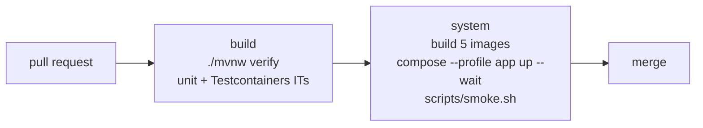
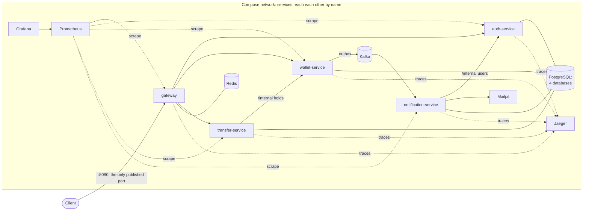

# Chapter 12 — Shipping it

> **Branch:** `ch12-shipping` · **Builds on:** [Chapter 11](11-observability.md) ·
> **Go reference:** `Dockerfile`, `docker-compose.yml` (`app` profile), `.github/workflows/ci.yml` (episode 16)

## What you'll learn

- How to build small, secure, cache-friendly container images for Spring Boot services
- Layered jars, and why layer order decides how fast you ship
- Running the whole system with one command, configured entirely by environment variables
- Network isolation: publishing only the gateway
- Secrets as files, not environment variables
- Health checks, graceful shutdown and container-aware JVM settings
- A CI pipeline that tests every service, then the **whole system**, on every pull request

## The problem

Until now, running the system meant starting five JVMs by hand, in the right order, with the right
flags. That's fine for learning and fatal for shipping. A deployable system needs:

- one artifact per service that runs the same on a laptop, in CI and in production;
- configuration that comes from the environment, not from editing files;
- a way to start everything, wait until it's actually ready, and stop it without dropping requests;
- proof, on every change, that the services still work **together**, not just one by one.

## The concepts

### One Dockerfile, three stages

```dockerfile
FROM eclipse-temurin:21-jdk-noble AS build          # 1. compile just this module, with Maven's cache
ARG SERVICE
COPY .mvn .mvn
COPY mvnw pom.xml ./
COPY */pom.xml ...                                   # every module's pom, so the reactor resolves
COPY ${SERVICE}/src ${SERVICE}/src
RUN --mount=type=cache,target=/root/.m2 ./mvnw -pl ${SERVICE} -am package -DskipTests

FROM eclipse-temurin:21-jdk-noble AS layers          # 2. split the jar into layers
RUN java -Djarmode=tools -jar app.jar extract --layers --launcher --destination extracted

FROM eclipse-temurin:21-jre-noble                    # 3. run: a JRE, a non-root user, the layers
RUN useradd --system --uid 10001 app
COPY --from=layers .../dependencies/ ./              # changes rarely
COPY --from=layers .../spring-boot-loader/ ./
COPY --from=layers .../snapshot-dependencies/ ./
COPY --from=layers .../application/ ./               # changes on every commit
USER app
ENV JAVA_TOOL_OPTIONS="-XX:MaxRAMPercentage=75 -XX:+ExitOnOutOfMemoryError"
ENTRYPOINT ["java", "org.springframework.boot.loader.launch.JarLauncher"]
```

Why each choice:

| Choice | Reason |
|---|---|
| Multi-stage | The runtime image has no JDK, no Maven, no source: smaller and less to attack |
| `--mount=type=cache,sharing=locked` for `~/.m2` | Dependencies download once, not once per service per build; `locked` stops parallel builds racing on it |
| Layered jar, dependencies first | Docker caches layers in order; a code change rebuilds and ships only the small `application` layer |
| JRE, not JDK, at runtime | No compiler in production |
| Non-root user | A compromised process can't own the container |
| `MaxRAMPercentage=75` | The heap follows the container's memory limit, not the host's |
| `ExitOnOutOfMemoryError` | A JVM in a broken state exits, and the platform restarts it, instead of limping |
| Exec-form `ENTRYPOINT` | The JVM is PID 1 and receives `SIGTERM`, so graceful shutdown (chapter 1) works |

The same Dockerfile builds all five services: `--build-arg SERVICE=wallet-service`.

### The system in Compose

```bash
docker compose --profile app up -d --build --wait
```

The infrastructure services have no profile, so `docker compose up` still starts only them (for
running services from your IDE, as in every earlier chapter). The five services are in the `app`
profile. `--wait` returns only once every container's health check passes.

**Configuration comes from the environment.** Every `application.yml` default (`localhost:5433`,
`localhost:9092`, ...) is right for a laptop; containers override them with environment variables
that Spring Boot's relaxed binding maps onto properties:

```yaml
transfer-service:
  environment:
    SPRING_DATASOURCE_URL: jdbc:postgresql://postgres:5432/transfer
    SPRING_KAFKA_BOOTSTRAP_SERVERS: kafka:29092
    SPRING_HTTP_SERVICECLIENT_WALLET_BASEURL: http://wallet-service:8081
    MANAGEMENT_OPENTELEMETRY_TRACING_EXPORT_OTLP_ENDPOINT: http://jaeger:4318/v1/traces
```

Same image, different environment: that's what makes one artifact work everywhere.

**Only the gateway is published.** The five services have no `ports:`. They can reach each other
on the Compose network by name, but nothing on your machine can reach them (we checked:
`curl localhost:8081` fails). This is the network rule that chapter 6's `X-User-ID` header relies on.

**Kafka needs two listeners.** A Kafka client connects, then reconnects to the address the broker
*advertises*. Containers must be told `kafka:29092`; your laptop must be told `localhost:9092`. One
listener per audience:

```yaml
KAFKA_LISTENERS: PLAINTEXT://:9092,INTERNAL://:29092,CONTROLLER://:9093
KAFKA_ADVERTISED_LISTENERS: PLAINTEXT://localhost:9092,INTERNAL://kafka:29092
```

**Secrets are files.** The auth service's signing key is a Compose secret mounted at
`/run/secrets/auth-signing-key`, and `AUTH_PRIVATE_KEY_LOCATION` points to it. Environment variables
leak into logs, crash reports and `docker inspect`; files don't.

> **A bug CI caught on the first run.** On macOS everything passed; on the Linux CI runner the
> auth service died with `/run/secrets/auth-signing-key (Permission denied)`. A Compose file
> secret is a bind mount, and on Linux it keeps the host file's owner and mode. Our script wrote
> the key with mode `600`, and the container runs as uid 10001, not as you. The dev key is now
> written `644` (it's a throwaway laptop key); in Kubernetes, a Secret volume's `defaultMode` and
> the pod's `fsGroup` set this for you. This is exactly why the `system` job exists: Docker
> Desktop hid the problem.

**Health checks gate startup.** Each service's health check calls its own
`/actuator/health/readiness`. The JRE image has no `curl`, so the check uses bash's `/dev/tcp`.
`depends_on: condition: service_healthy` encodes the order: the gateway waits for auth, wallet and
transfer; the transfer service waits for the wallet; the notification service waits for auth and
Kafka.

> Health-check ordering is a convenience for local startup, not a correctness mechanism. In production
> services restart independently, and every dependency can vanish at any time: that's why chapters 7–10
> built the outbox, retries, sagas and circuit breakers.

**Graceful shutdown.** `docker compose stop wallet-service` sends `SIGTERM`; the logs show
`Graceful shutdown complete` before the connection pool closes. `stop_grace_period: 30s` gives
in-flight requests time to finish.

### CI: test the parts, then the whole



The `system` job is the only place where the *real* services talk to each other: the real gateway
verifying real tokens from the real auth service, the real saga calling the real wallet, the real
email arriving. Each service's own tests use fakes for its neighbours (`FakeWallet`, `FakeAuth`,
`FakeServices`), so the smoke test is what catches a contract drifting between two of them.

[`scripts/smoke.sh`](../scripts/smoke.sh) drives the system only through the gateway: sign up two
users, open wallets, deposit, transfer, wait for the saga to complete, check both balances, check
three emails arrived in Mailpit, and check `/internal/**` is unreachable. If any step fails, CI
prints the last 200 log lines of every container.

## Architecture: the final system



## Step by step

1. [`Dockerfile`](../Dockerfile) and [`.dockerignore`](../.dockerignore) (the build context skips
   `.git`, `reference/`, `docs/`, `target/` and `secrets/`).
2. [`docker-compose.yml`](../docker-compose.yml): a shared `x-service` block (profile, restart
   policy, common environment, grace period) and an `x-ready` health check block, merged into each
   service with YAML anchors; Kafka's second listener; the `auth-signing-key` secret.
3. [`deploy/prometheus/prometheus.yml`](../deploy/prometheus/prometheus.yml): a second scrape job
   for the containers by name. Whichever way you run the services, one job is up.
4. [`scripts/smoke.sh`](../scripts/smoke.sh).
5. [`.github/workflows/ci.yml`](../.github/workflows/ci.yml): the `system` job, after `build`.

## Run it

```bash
./scripts/dev-keys.sh
docker compose --profile app up -d --build --wait
./scripts/smoke.sh
```

Our run while writing this chapter: with a warm Maven cache the build and start took under a minute
(a cold first build also downloads every dependency, so expect several minutes); `--wait` returned with all twelve containers healthy or running; the smoke test printed
`SMOKE PASSED`; Prometheus showed the five containers `UP` by name. Then open
http://localhost:8025 (emails), http://localhost:16686 (traces) and http://localhost:3000 (dashboard).

```bash
docker compose --profile app down -v
```

## How this connects

This chapter adds no business features. It turns twelve chapters of code into something you can hand
to someone else: one command to run, one pipeline that proves it works. Every earlier guarantee —
balanced books, no double spending, exactly-once effects, compensations, idempotent consumers, fast
failures, one trace per transfer — is now checked end to end on every pull request.

## Key takeaways

- Build images in stages; ship a JRE, a non-root user and layers ordered by how often they change.
- Make the JVM container-aware, and let it receive `SIGTERM`.
- One image per service, configured by its environment.
- Publish only the entry point; keep services and their internal APIs on the private network.
- Mount secrets as files.
- Readiness checks gate startup locally; resilience patterns handle it in production.
- Test services alone with fakes, then the whole system for real, on every change.

## Where to go next

The Go reference goes further, and each topic is a good project on top of this course, with the
reference code as your guide:

| Topic | Go episode | Ideas |
|---|---|---|
| Outbound webhooks | 17 | Signed deliveries (HMAC), retries, a delivery log, replay; a new consumer of `wallet.events` |
| Multi-currency and FX | 18 | Quotes that expire, exact rates with `BigDecimal`, four-entry postings, fees |
| Fraud and risk checks | 19 | Velocity limits in Redis, a rules engine, an `in_review` saga state |
| Reconciliation and reporting | 20 | Scheduled jobs with leader election, nightly ledger checks, CSV statements |
| Security hardening | 21 | mTLS between services, least-privilege database roles, an audit log |
| Performance | 22 | Load tests that tell the truth, profiling, a bulkhead for reports |
| Kubernetes | 23 | A Helm chart, probes, rolling updates, autoscaling |
| Chaos | 24 | Toxiproxy faults, a game day, proving the books still balance |

## Exercises

1. Build images with Cloud Native Buildpacks instead (`./mvnw -pl wallet-service spring-boot:build-image`)
   and compare size, build time and what you had to write.
2. Add a `readOnly: true` root filesystem and `cap_drop: [ALL]` to the services, as the Go reference does.
   What does the JVM need writable? (Hint: `/tmp`.)
3. Push images to GitHub Container Registry from CI on merges to `main`, tagged with the commit SHA.
4. Make the smoke test also prove idempotency: send the transfer twice with the same key and check
   the balance moved once.
