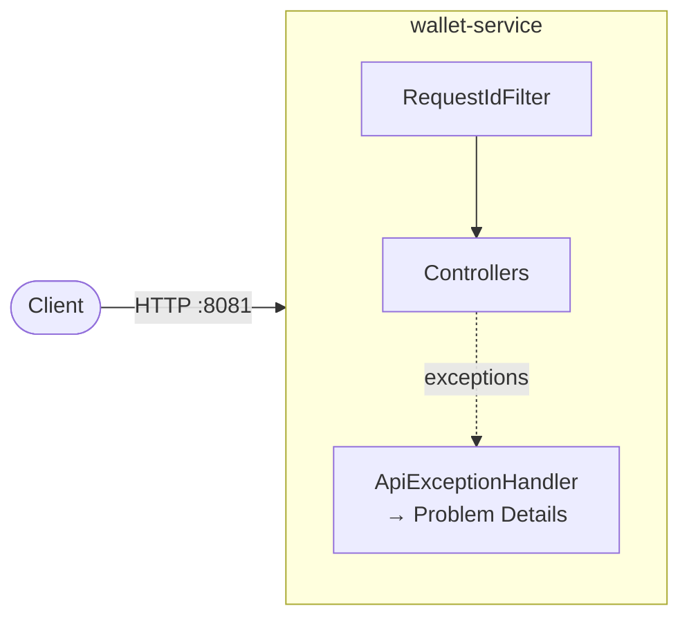

# Architecture — the system as it is now

> This page describes the code on the branch you are reading. Every chapter updates it.

## After chapter 1

One service, no database yet.



### Modules

| Module | Port | Description |
|---|---|---|
| `wallet-service` | 8081 | Skeleton: configuration, error contract, request IDs, health probes |

### Cross-cutting conventions (every service follows them)

- **Errors:** RFC 9457 Problem Details with a stable `code`, `fields` for validation errors, and
  `request_id`. Business code throws sealed `PaymentsException`s; one advice maps them to HTTP.
- **JSON:** snake_case.
- **Logs:** every line carries `[service-name,request-id]`.
- **Health:** `/actuator/health/liveness` and `/actuator/health/readiness`.
- **Tests:** `*Test` run in `mvn test`; `*IT` (full application, real containers) in `mvn verify`.

### Package layout (wallet-service)

```
dev.payments.wallet
├── WalletApplication
├── config     WalletProperties
├── error      PaymentsException hierarchy, FieldErrors
├── money      Money, MoneyRules
└── web        ApiExceptionHandler, RequestIdFilter
```
