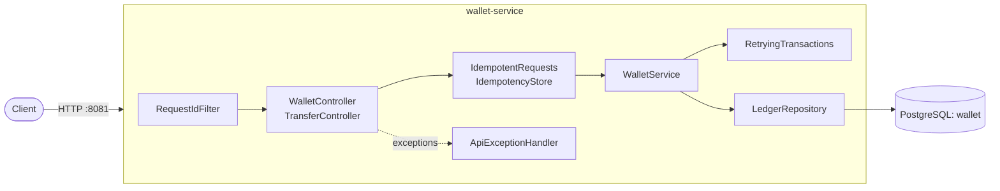

# Architecture — the system as it is now

> This page describes the code on the branch you are reading. Every chapter updates it.

## After chapter 4

One service with its own database.



### Services and infrastructure

| Component | Port | Description |
|---|---|---|
| `wallet-service` | 8081 | Wallets, deposits, balances, entries: the double-entry ledger |
| PostgreSQL 17 | 5433 (host) | One database per service; today only `wallet` |

### wallet-service API

| Method | Path | Notes |
|---|---|---|
| `POST` | `/v1/wallets` | `{"owner_id", "currency"}`; one wallet per owner and currency |
| `GET` | `/v1/wallets/{id}` | System accounts are invisible (404) |
| `GET` | `/v1/wallets/{id}/balance` | Derived from entries |
| `POST` | `/v1/wallets/{id}/deposits` | Debits settlement, credits the wallet; needs `Idempotency-Key` |
| `GET` | `/v1/wallets/{id}/entries` | Newest first; `limit` (1–100, default 20) and opaque `cursor` |
| `POST` | `/v1/transfers` | `{"from", "to", "amount", "currency"}`; same currency; `insufficient_funds` (422); needs `Idempotency-Key` |

### Idempotency

Every request that moves money needs an `Idempotency-Key` header (1–255 chars). The first request
runs; the response is stored **in the same transaction** as the ledger entries; retries get the same
bytes back with `Idempotent-Replayed: true`. Errors: `idempotency_key_required` (400),
`idempotency_key_reused` (422), `request_in_progress` (409). Keys live 24 h; claims expire after 1 min.

### Concurrency rules

- A transfer locks both wallets (`SELECT ... FOR UPDATE`), **lower UUID first**, then checks the balance.
- Transactions that hit a deadlock or serialization failure are retried whole, up to 5 attempts,
  with exponential backoff and jitter (`RetryingTransactions`, READ COMMITTED). Only the outermost
  transaction retries; nested calls join it.

### wallet database

| Table / view | Purpose |
|---|---|
| `accounts` | Wallets (`kind = wallet`, have an owner) and system accounts (`settlement` per currency) |
| `transactions` | The journal: one row per movement of money |
| `entries` | Debits and credits; append-only; balanced per transaction at commit |
| `account_balances` (view) | Balances derived from entries |
| `idempotency_keys` | One row per key: fingerprint, status, the stored response |

### Cross-cutting conventions (every service follows them)

- **Errors:** RFC 9457 Problem Details with a stable `code`, `fields` for validation errors, and
  `request_id`. Business code throws sealed `PaymentsException`s; one advice maps them to HTTP.
- **JSON:** snake_case. Money is `{"amount": <minor units>, "currency": "USD"}`.
- **Logs:** every line carries `[service-name,request-id]`.
- **Health:** `/actuator/health/liveness` and `/actuator/health/readiness`.
- **Data:** Flyway migrations, `JdbcClient` SQL, invariants enforced in the database.
- **Tests:** `*Test` run in `mvn test`; `*IT` (full application, PostgreSQL via Testcontainers) in `mvn verify`.

### Package layout (wallet-service)

```
dev.payments.wallet
├── WalletApplication
├── config     WalletProperties
├── error      PaymentsException hierarchy (incl. IdempotencyException), FieldErrors
├── idempotency IdempotencyKey, IdempotencyStore, IdempotentRequests, IdempotencyCleanup
├── ledger     Account, Entry, Transaction, Transfer, Posting, LedgerRepository, WalletService,
│              RetryingTransactions, WalletController, TransferController, Cursor
├── money      Money, MoneyRules
└── web        ApiExceptionHandler, RequestIdFilter
```
