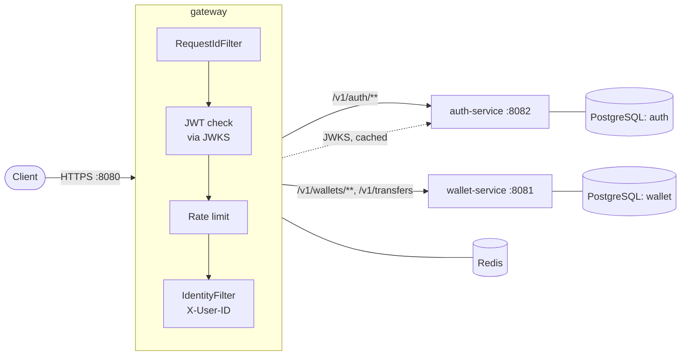
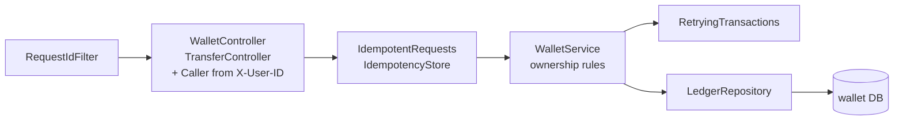

# Architecture — the system as it is now

> This page describes the code on the branch you are reading. Every chapter updates it.

## After chapter 6

Clients talk only to the gateway. It verifies tokens, limits rates, and routes to two services, each
with its own database.



Inside wallet-service:



### Services and infrastructure

| Component | Port | Description |
|---|---|---|
| `gateway` | 8080 | The only public entry point: JWT verification, `X-User-ID`, Redis rate limits, CORS, routing |
| `wallet-service` | 8081 | Wallets, deposits, balances, entries, transfers: the double-entry ledger |
| `auth-service` | 8082 | Users, argon2id passwords, RS256 access tokens, rotating refresh tokens, JWKS |
| PostgreSQL 17 | 5433 (host) | One database per service: `wallet`, `auth` |
| Redis 7 | 6379 | Gateway rate-limit buckets |

### gateway routes

| Path | Service | Token |
|---|---|---|
| `/v1/auth/register`, `/login`, `/refresh`, `/logout` | auth-service | not needed |
| `/v1/auth/me` | auth-service | required |
| `/v1/wallets/**`, `/v1/transfers` | wallet-service | required |

Every request: `X-Request-ID` set or kept; any client `X-User-ID` removed, then set from the token's
`sub`; token bucket per user (or IP): 10/s, burst 20; 5 s response timeout.

### auth-service API

| Method | Path | Notes |
|---|---|---|
| `POST` | `/v1/auth/register` | `{"email", "password"}`; email case-insensitive unique; password 12–128 chars |
| `POST` | `/v1/auth/login` | Returns `access_token` (JWT, 15 min), `refresh_token` (opaque, 30 days) |
| `POST` | `/v1/auth/refresh` | Rotates; reusing a rotated token revokes its whole family |
| `POST` | `/v1/auth/logout` | Revokes the token's family |
| `GET` | `/v1/auth/me` | Needs `Authorization: Bearer <access token>` |
| `GET` | `/.well-known/jwks.json` | Public signing keys |

Access token claims: `iss=payments-auth`, `aud=[payments]`, `sub=<user id>`, `iat`, `exp`, `jti`; header `kid`.

### auth database

| Table | Purpose |
|---|---|
| `users` | `email citext UNIQUE`, `password_hash` (argon2id PHC string) |
| `refresh_tokens` | SHA-256 of each token, its family, parent, rotated/revoked/expiry times |

### wallet-service API

Every request needs `X-User-ID` (set by the gateway; missing ⇒ 401). Wallets are visible only to
their owner (others get 404). A transfer's `from` must be the caller's wallet; `to` may be anyone's.

| Method | Path | Notes |
|---|---|---|
| `POST` | `/v1/wallets` | `{"currency"}`; the owner is the caller; one wallet per owner and currency |
| `GET` | `/v1/wallets/{id}` | System accounts are invisible (404) |
| `GET` | `/v1/wallets/{id}/balance` | Derived from entries |
| `POST` | `/v1/wallets/{id}/deposits` | Debits settlement, credits the wallet; needs `Idempotency-Key` |
| `GET` | `/v1/wallets/{id}/entries` | Newest first; `limit` (1–100, default 20) and opaque `cursor` |
| `POST` | `/v1/transfers` | `{"from", "to", "amount", "currency"}`; same currency; `insufficient_funds` (422); needs `Idempotency-Key` |

### Idempotency

Every request that moves money needs an `Idempotency-Key` header (1–255 chars), unique per user. The first request
runs; the response is stored **in the same transaction** as the ledger entries; retries get the same
bytes back with `Idempotent-Replayed: true`. Errors: `idempotency_key_required` (400),
`idempotency_key_reused` (422), `request_in_progress` (409). Keys live 24 h; claims expire after 1 min.

### Concurrency rules

- A transfer locks both wallets (`SELECT ... FOR UPDATE`), **lower UUID first**, then checks the balance.
- Transactions that hit a deadlock or serialization failure are retried whole, up to 5 attempts,
  with exponential backoff and jitter (`RetryingTransactions`, READ COMMITTED). Only the outermost
  transaction retries; nested calls join it.

### wallet database

| Table / view | Purpose |
|---|---|
| `accounts` | Wallets (`kind = wallet`, have an owner) and system accounts (`settlement` per currency) |
| `transactions` | The journal: one row per movement of money |
| `entries` | Debits and credits; append-only; balanced per transaction at commit |
| `account_balances` (view) | Balances derived from entries |
| `idempotency_keys` | One row per key: fingerprint, status, the stored response |

### Cross-cutting conventions (every service follows them)

- **Errors:** RFC 9457 Problem Details with a stable `code`, `fields` for validation errors, and
  `request_id`. Business code throws sealed `PaymentsException`s; one advice maps them to HTTP.
- **JSON:** snake_case. Money is `{"amount": <minor units>, "currency": "USD"}`.
- **Logs:** every line carries `[service-name,request-id]`.
- **Health:** `/actuator/health/liveness` and `/actuator/health/readiness`.
- **Data:** Flyway migrations, `JdbcClient` SQL, invariants enforced in the database.
- **Identity:** the gateway authenticates; services read `X-User-ID` and authorize.
- **Tests:** `*Test` run in `mvn test`; `*IT` (full application, real containers) in `mvn verify`.

### Package layout

gateway: `dev.payments.gateway` — `GatewayApplication`, `GatewayProperties`, `SecurityConfig`,
`ProblemEntryPoint`, `RequestIdFilter`, `IdentityFilter`, `RateLimitConfig`; routes in `application.yml`.

auth-service: `dev.payments.auth` — `AuthApplication`, `AuthProperties`, `error`, `web`
(incl. `ProblemAuthenticationEntryPoint`), `security` (`SecurityConfig`), `token` (`SigningKeyConfig`,
`AccessTokens`, `JwksController`), `user` (`AuthService`, `AuthController`, repositories).

wallet-service:

```
dev.payments.wallet
├── WalletApplication
├── config     WalletProperties
├── error      PaymentsException hierarchy (incl. Idempotency-, UnauthenticatedException), FieldErrors
├── idempotency IdempotencyKey, IdempotencyStore, IdempotentRequests, IdempotencyCleanup
├── ledger     Account, Entry, Transaction, Transfer, Posting, LedgerRepository, WalletService,
│              RetryingTransactions, WalletController, TransferController, Cursor
├── money      Money, MoneyRules
└── web        ApiExceptionHandler, RequestIdFilter, Caller, CallerArgumentResolver, WebConfig
```
