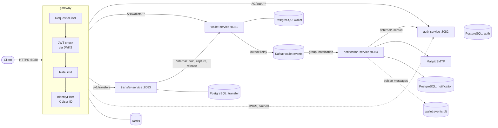
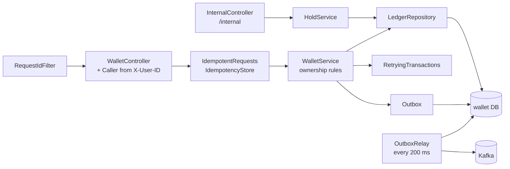

# Architecture — the system as it is now

> This page describes the code on the branch you are reading. Every chapter updates it.

## After chapter 9

Clients talk only to the gateway. It verifies tokens, limits rates, and routes to three services, each
with its own database. Transfers run as sagas: the transfer service orchestrates holds in the wallet
over its internal HTTP API. The wallet publishes events to Kafka through a transactional outbox, and
the notification service consumes them to email users.



Inside wallet-service:



### Services and infrastructure

| Component | Port | Description |
|---|---|---|
| `gateway` | 8080 | The only public entry point: JWT verification, `X-User-ID`, Redis rate limits, CORS, routing |
| `wallet-service` | 8081 | Wallets, deposits, balances, entries, transfers: the double-entry ledger |
| `auth-service` | 8082 | Users, argon2id passwords, RS256 access tokens, rotating refresh tokens, JWKS |
| `transfer-service` | 8083 | Transfers between users as orchestrated sagas over wallet holds |
| `notification-service` | 8084 | Emails users about deposits and transfers, from `wallet.events`; no public API |
| PostgreSQL 17 | 5433 (host) | One database per service: `wallet`, `auth`, `transfer`, `notification` |
| Redis 7 | 6379 | Gateway rate-limit buckets |
| Kafka 4.2 (KRaft) | 9092 | Events; topic auto-creation off |
| Mailpit | 1025 (SMTP), 8025 (UI) | Catches every email |

### gateway routes

| Path | Service | Token |
|---|---|---|
| `/v1/auth/register`, `/login`, `/refresh`, `/logout` | auth-service | not needed |
| `/v1/auth/me` | auth-service | required |
| `/v1/wallets/**` | wallet-service | required |
| `/v1/transfers/**` | transfer-service | required |
| `/internal/**` | — (no route: 404) | — |

Every request: `X-Request-ID` set or kept; any client `X-User-ID` removed, then set from the token's
`sub`; token bucket per user (or IP): 10/s, burst 20; 5 s response timeout.

### auth-service API

| Method | Path | Notes |
|---|---|---|
| `POST` | `/v1/auth/register` | `{"email", "password"}`; email case-insensitive unique; password 12–128 chars |
| `POST` | `/v1/auth/login` | Returns `access_token` (JWT, 15 min), `refresh_token` (opaque, 30 days) |
| `POST` | `/v1/auth/refresh` | Rotates; reusing a rotated token revokes its whole family |
| `POST` | `/v1/auth/logout` | Revokes the token's family |
| `GET` | `/v1/auth/me` | Needs `Authorization: Bearer <access token>` |
| `GET` | `/.well-known/jwks.json` | Public signing keys |

Internal (no gateway route): `GET /internal/users/{id}` → `{id, email}`, for the notification service.

Access token claims: `iss=payments-auth`, `aud=[payments]`, `sub=<user id>`, `iat`, `exp`, `jti`; header `kid`.

### auth database

| Table | Purpose |
|---|---|
| `users` | `email citext UNIQUE`, `password_hash` (argon2id PHC string) |
| `refresh_tokens` | SHA-256 of each token, its family, parent, rotated/revoked/expiry times |

### wallet-service API

Every request needs `X-User-ID` (set by the gateway; missing ⇒ 401). Wallets are visible only to
their owner (others get 404). A transfer's `from` must be the caller's wallet; `to` may be anyone's.

| Method | Path | Notes |
|---|---|---|
| `POST` | `/v1/wallets` | `{"currency"}`; the owner is the caller; one wallet per owner and currency |
| `GET` | `/v1/wallets/{id}` | System accounts are invisible (404) |
| `GET` | `/v1/wallets/{id}/balance` | Derived from entries |
| `POST` | `/v1/wallets/{id}/deposits` | Debits settlement, credits the wallet; needs `Idempotency-Key` |
| `GET` | `/v1/wallets/{id}/entries` | Newest first; `limit` (1–100, default 20) and opaque `cursor` |

### wallet-service internal API (no gateway route; called by transfer-service)

| Method | Path | Notes |
|---|---|---|
| `GET` | `/internal/wallets/{id}` | `{id, owner_id, currency}` |
| `PUT` | `/internal/holds/{id}` | `{wallet_id, owner_id, amount, currency}`; idempotent by hold id; `insufficient_funds` |
| `POST` | `/internal/holds/{id}/capture` | `{to_wallet_id}`; idempotent; `hold_settled`, `currency_mismatch`; emits `transfer.completed` |
| `POST` | `/internal/holds/{id}/release` | idempotent; `hold_settled` if captured |

### transfer-service API

| Method | Path | Notes |
|---|---|---|
| `POST` | `/v1/transfers` | `{"from", "to", "amount", "currency"}` + `Idempotency-Key`; validates wallets; `202 Accepted` + `Location`; 503 if the wallet is unreachable |
| `GET` | `/v1/transfers/{id}` | Sender only; `state`, `failure_reason`, `steps` |

Saga: `pending →(hold) funds_held →(capture) completed`; refused hold ⇒ `failed`; refused capture ⇒
`compensating →(release, retried forever) reversed`. 4xx = refusal, 5xx/timeout = retry with
exponential backoff and jitter. Claims are 10 s leases; writes are guarded by `version`.

### notification-service

Consumer group `notification` on `wallet.events` (3 threads). Deposit ⇒ email the owner; transfer ⇒
email receiver and sender. Deduplicated by `notifications (event_id, user_id)` primary key. Transient
failures retried 4× with exponential backoff (500 ms ×2); permanent ones (bad JSON, unknown user) and
exhausted ones go to `wallet.events.dlt`. New groups start at `earliest`.

### transfer database

| Table | Purpose |
|---|---|
| `transfers` | One row per saga: state, failure reason, attempts, next attempt, version; `UNIQUE (user_id, idempotency_key)` |
| `transfer_steps` | Every try of every step |

### Idempotency

Every request that moves money needs an `Idempotency-Key` header (1–255 chars), unique per user. The first request
runs; the response is stored **in the same transaction** as the ledger entries; retries get the same
bytes back with `Idempotent-Replayed: true`. Errors: `idempotency_key_required` (400),
`idempotency_key_reused` (422), `request_in_progress` (409). Keys live 24 h; claims expire after 1 min.

### Concurrency rules

- Placing a hold locks the wallet (`SELECT ... FOR UPDATE`), then checks the balance. Settling a hold locks the hold.
- Transactions that hit a deadlock or serialization failure are retried whole, up to 5 attempts,
  with exponential backoff and jitter (`RetryingTransactions`, READ COMMITTED). Only the outermost
  transaction retries; nested calls join it.

### wallet database

| Table / view | Purpose |
|---|---|
| `accounts` | Wallets (`kind = wallet`, have an owner) and system accounts (`settlement` and `holds` per currency) |
| `transactions` | The journal: one row per movement of money |
| `entries` | Debits and credits; append-only; balanced per transaction at commit |
| `account_balances` (view) | Balances derived from entries |
| `idempotency_keys` | One row per key: fingerprint, status, the stored response |
| `outbox` | Events written with the change they describe; `published_at` set by the relay |
| `holds` | Money set aside for a transfer saga: `held`, `captured` or `released` |

### wallet events (topic `wallet.events`, 3 partitions, key = wallet id)

Envelope: `{"id", "type", "occurred_at", "aggregate_id", "data"}`; the `event_id` is also a header.
Delivery is at least once: consumers deduplicate by `id`.

| Type | `data` |
|---|---|
| `wallet.wallet.created.v1` | `wallet {id, owner_id, currency}` |
| `wallet.deposit.completed.v1` | `transaction_id`, `wallet`, `amount` |
| `wallet.transfer.completed.v1` | `transaction_id`, `from`, `to`, `amount` (keyed by `from`); emitted when a hold is captured |

### Cross-cutting conventions (every service follows them)

- **Errors:** RFC 9457 Problem Details with a stable `code`, `fields` for validation errors, and
  `request_id`. Business code throws sealed `PaymentsException`s; one advice maps them to HTTP.
- **JSON:** snake_case. Money is `{"amount": <minor units>, "currency": "USD"}`.
- **Logs:** every line carries `[service-name,request-id]`.
- **Health:** `/actuator/health/liveness` and `/actuator/health/readiness`.
- **Data:** Flyway migrations, `JdbcClient` SQL, invariants enforced in the database.
- **Events:** written to an outbox in the same transaction as the change; relayed to Kafka; versioned types.
- **Identity:** the gateway authenticates; services read `X-User-ID` and authorize.
- **Tests:** `*Test` run in `mvn test`; `*IT` (full application, real containers) in `mvn verify`.

### Package layout

gateway: `dev.payments.gateway` — `GatewayApplication`, `GatewayProperties`, `SecurityConfig`,
`ProblemEntryPoint`, `RequestIdFilter`, `IdentityFilter`, `RateLimitConfig`; routes in `application.yml`.

notification-service: `dev.payments.notification` — `WalletEventListener`, `Notifications` (who gets
what), `Notifier` (dedupe + send), `WalletEvent` (tolerant reader), `AuthClient`, `KafkaConfig`
(error handler, DLT).

transfer-service: `dev.payments.transfer` — `TransferApplication`, `TransferProperties`, `error`, `web`,
`saga` (`State`, `Saga`, `StepOutcome`, `Transfer`, `TransferRepository`, `SagaOrchestrator`,
`TransferService`, `TransferController`), `wallet` (`WalletClient`, `WalletClientConfig`, `WalletSteps`).

auth-service: `dev.payments.auth` — `AuthApplication`, `AuthProperties`, `error`, `web`
(incl. `ProblemAuthenticationEntryPoint`), `security` (`SecurityConfig`), `token` (`SigningKeyConfig`,
`AccessTokens`, `JwksController`), `user` (`AuthService`, `AuthController`, repositories).

wallet-service:

```
dev.payments.wallet
├── WalletApplication
├── config     WalletProperties
├── error      PaymentsException hierarchy (incl. Idempotency-, UnauthenticatedException), FieldErrors
├── events     WalletEvents (the contract), Outbox, OutboxRelay, OutboxProperties, KafkaTopicConfig
├── idempotency IdempotencyKey, IdempotencyStore, IdempotentRequests, IdempotencyCleanup
├── holds      Hold, HoldRepository, HoldService, InternalController
├── ledger     Account, Entry, Transaction, Posting, LedgerRepository, WalletService,
│              RetryingTransactions, WalletController, Cursor
├── money      Money, MoneyRules
└── web        ApiExceptionHandler, RequestIdFilter, Caller, CallerArgumentResolver, WebConfig
```
